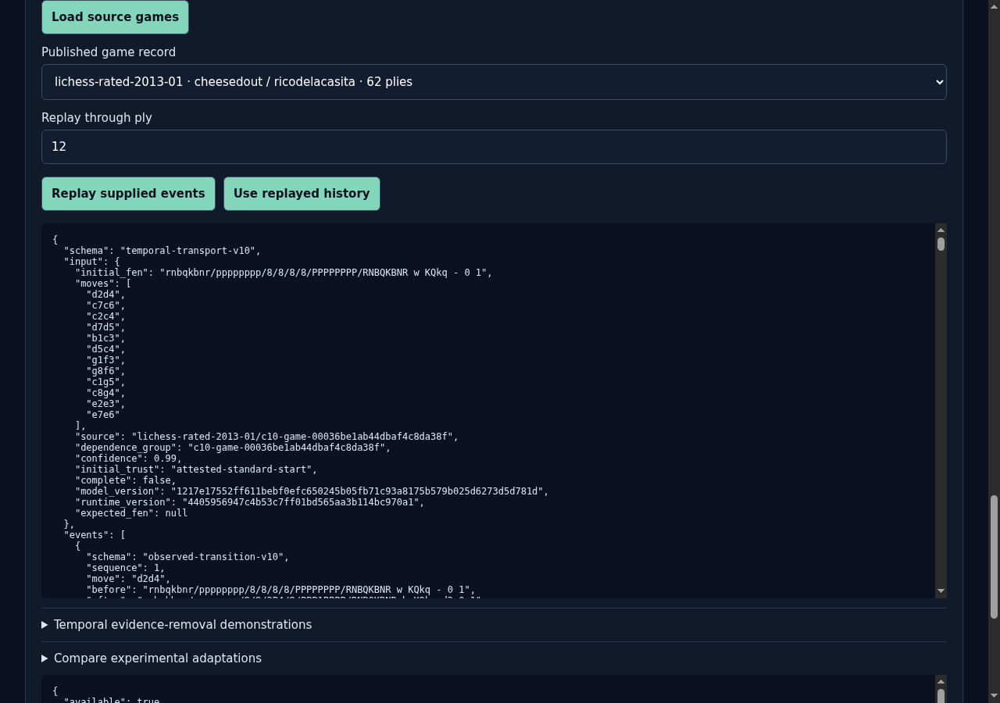
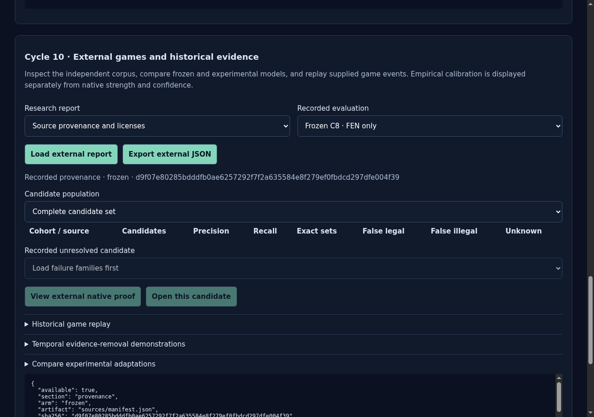
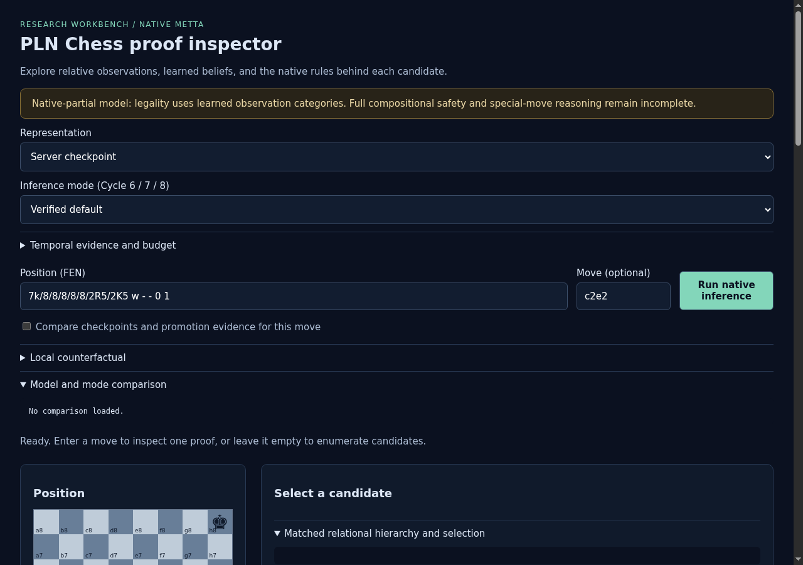
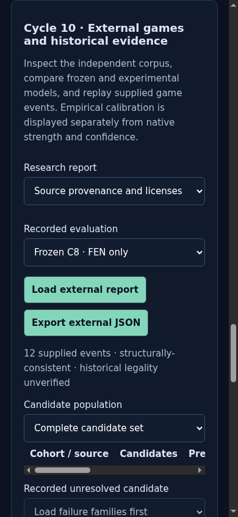

# ProofShot Verification Report

**Date:** 2026-11-09 18:05:41
**Project:** pln-chess-cycle10-ui-preview-2
**Dev Server:** exec /data/pln-chess-cycle6-delivery/.venv/bin/python /data/pln-chess-cycle10-ui-preview-2/owned-server.py on localhost:18781

## What Was Verified

Cycle 10 read-only source provenance and structural event replay, desktop/mobile; no native inference during benchmark

## Video Recording

Full session recording: [session.webm](./session.webm) (7s)

## Screenshots

## Console Errors

No console errors detected.

## Server Errors

No server errors detected.

## Environment
- Browser: Chromium (headless)
- Viewport: 1280x720
- Duration: 7 seconds
