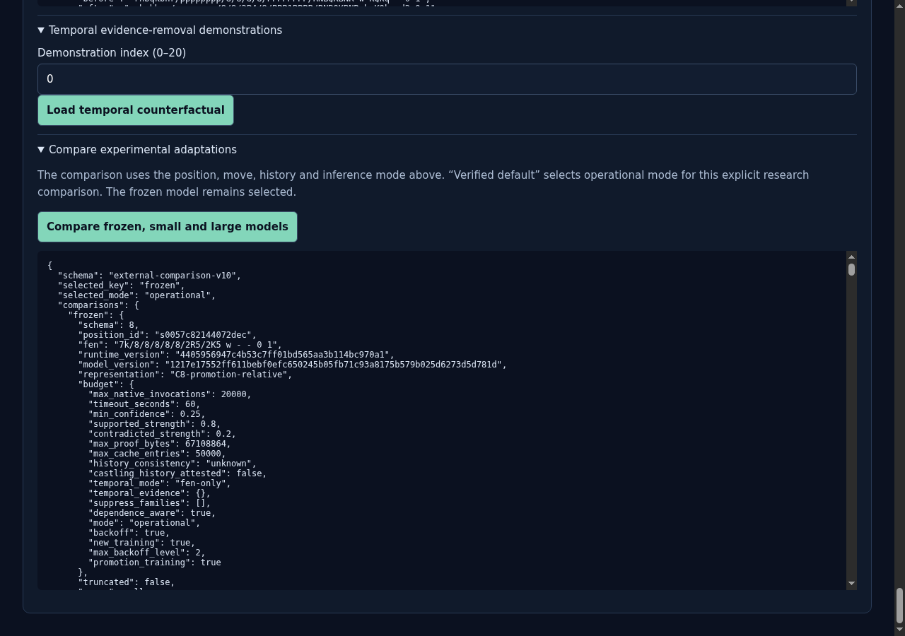
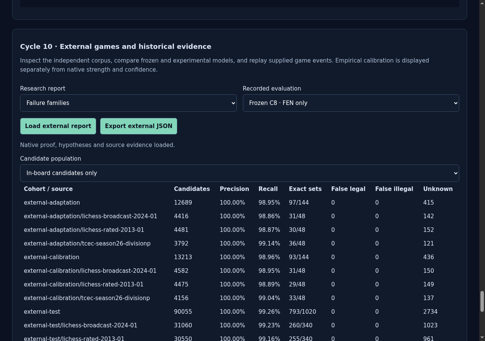
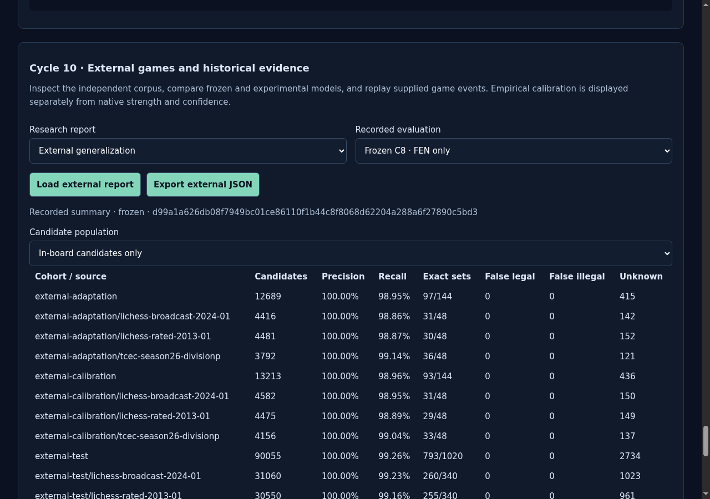
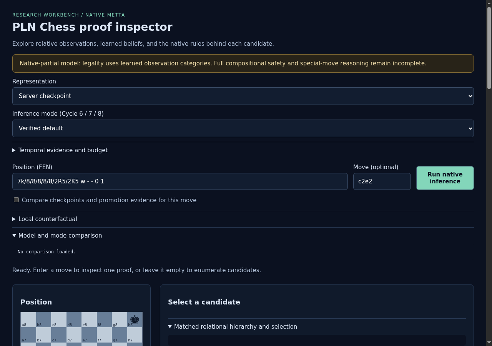
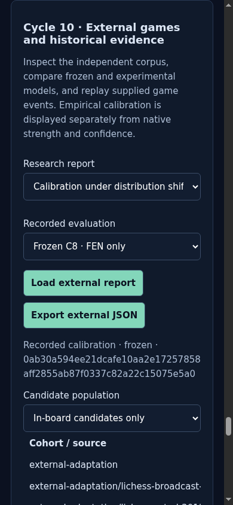
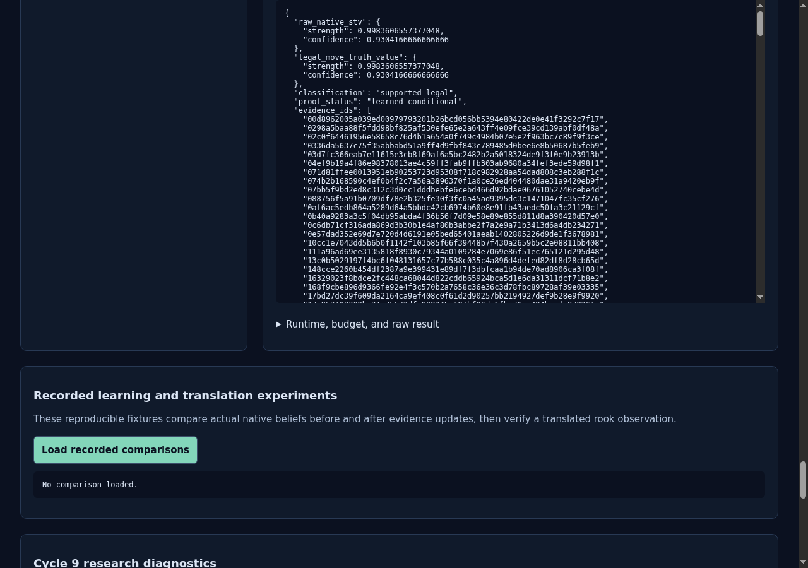
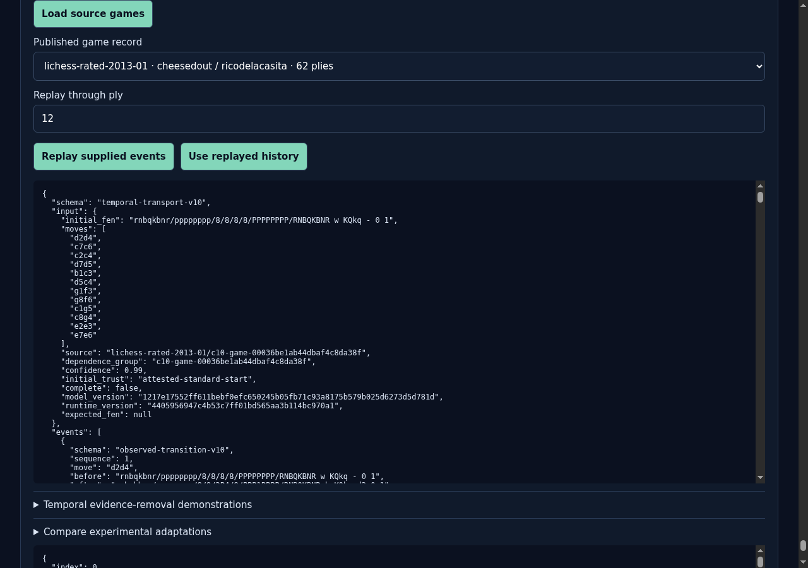
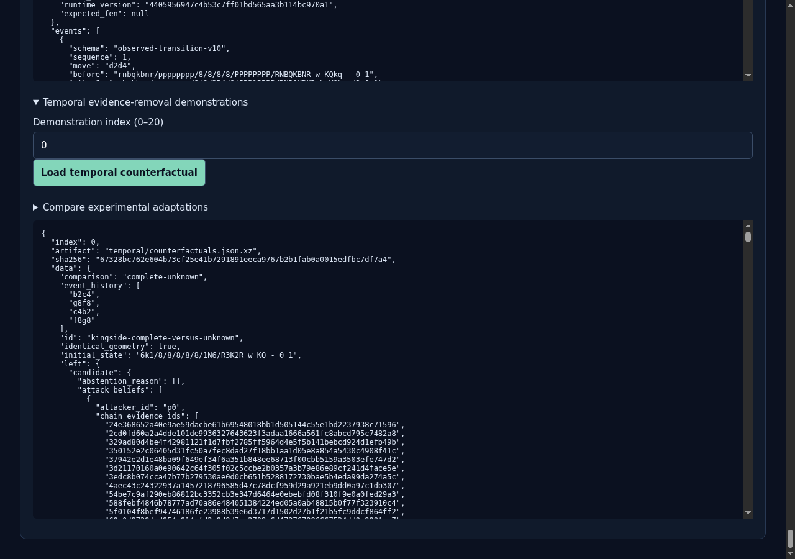

# ProofShot Verification Report

**Date:** 2026-11-09 22:33:34
**Project:** pln-chess-cycle10-browser-final-1
**Dev Server:** exec /data/pln-chess-cycle6-delivery/.venv/bin/python /data/pln-chess-cycle10-browser-final-1/owned-server.py on localhost:18780

## What Was Verified

Cycle 10 accepted model, external sources, calibration shift, failure proofs, historical replay, adaptation comparisons, report export and mobile layout

## Video Recording

Full session recording: [session.webm](./session.webm) (77s)

## Screenshots

## Console Errors

No console errors detected.

## Server Errors

No server errors detected.

## Environment
- Browser: Chromium (headless)
- Viewport: 1280x720
- Duration: 77 seconds
