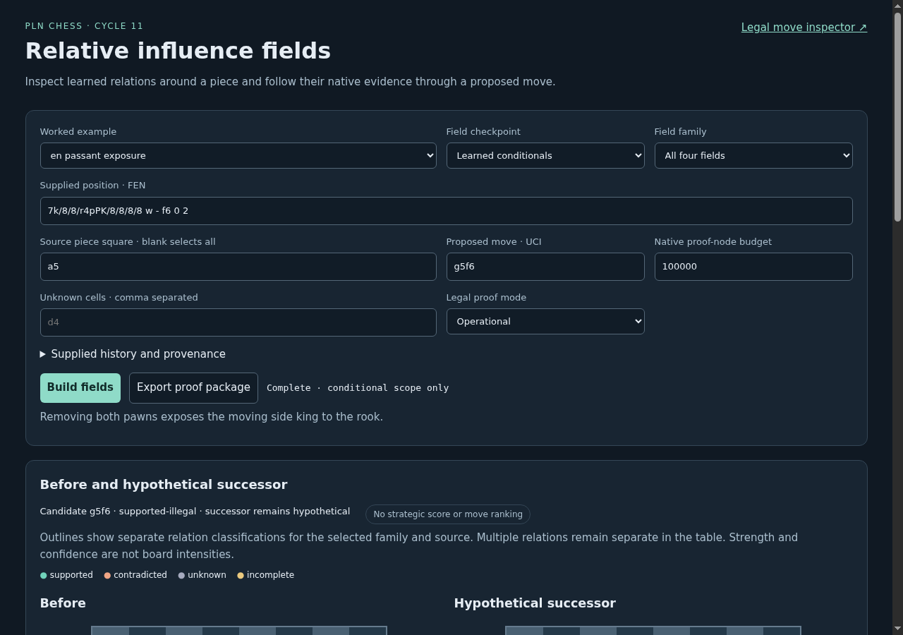
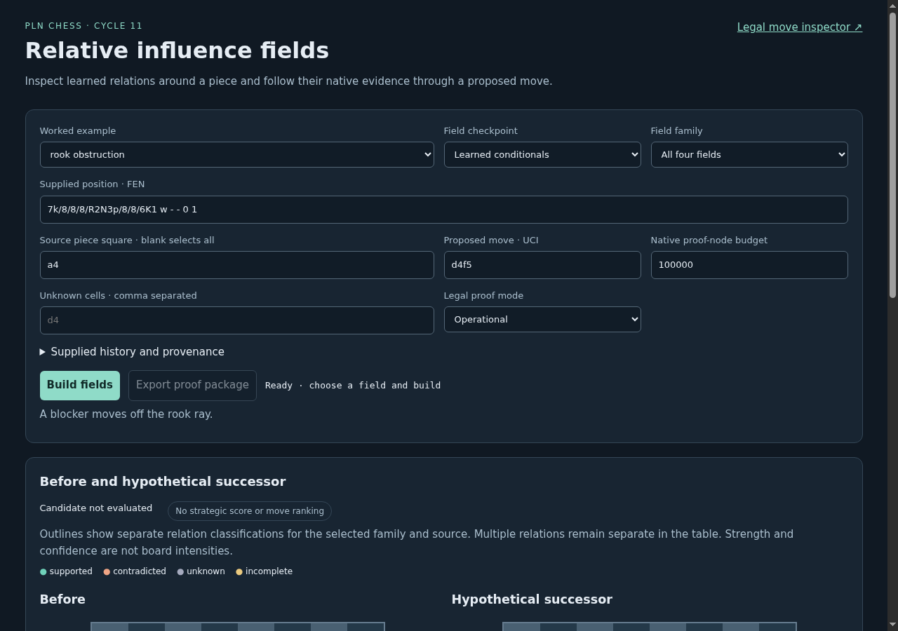
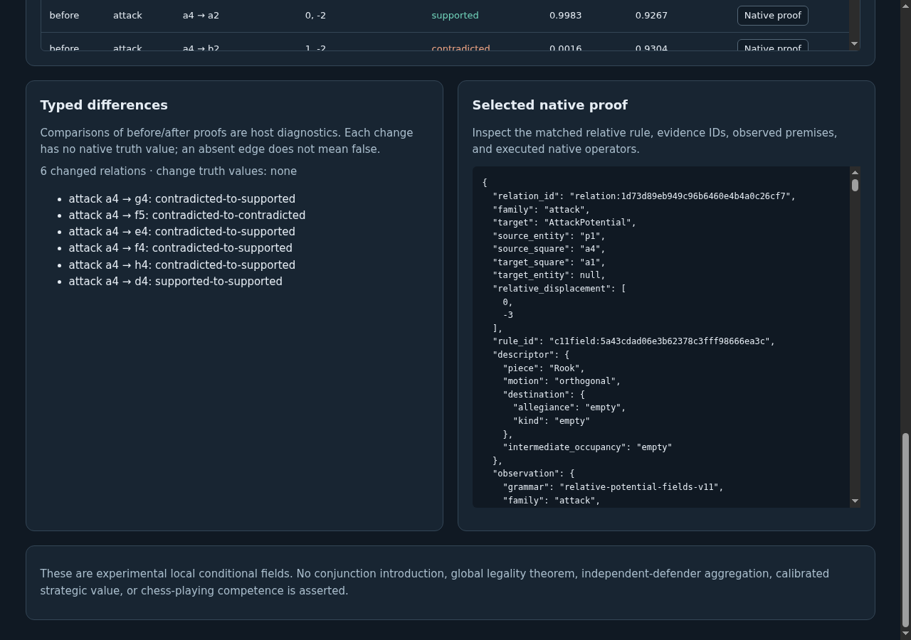
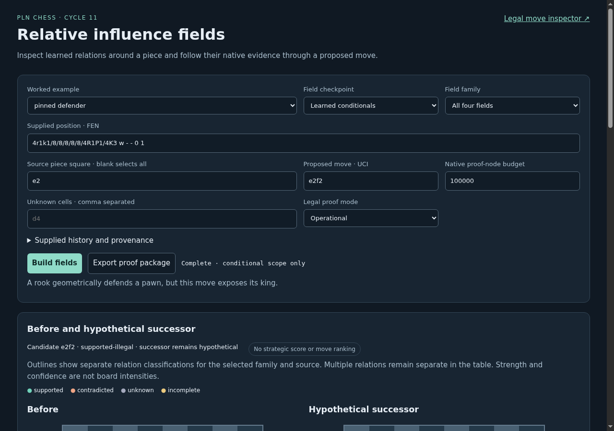
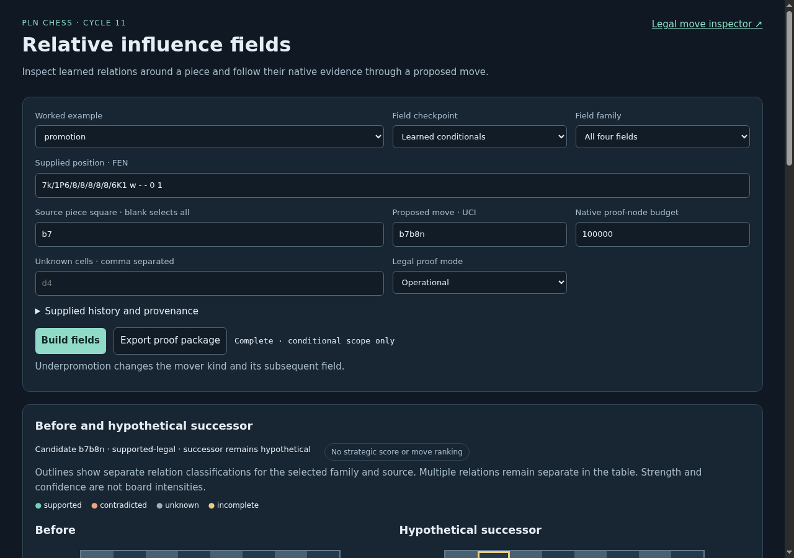
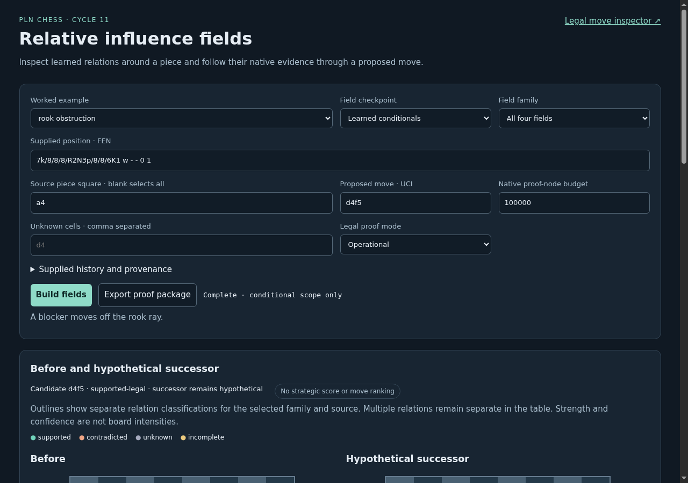
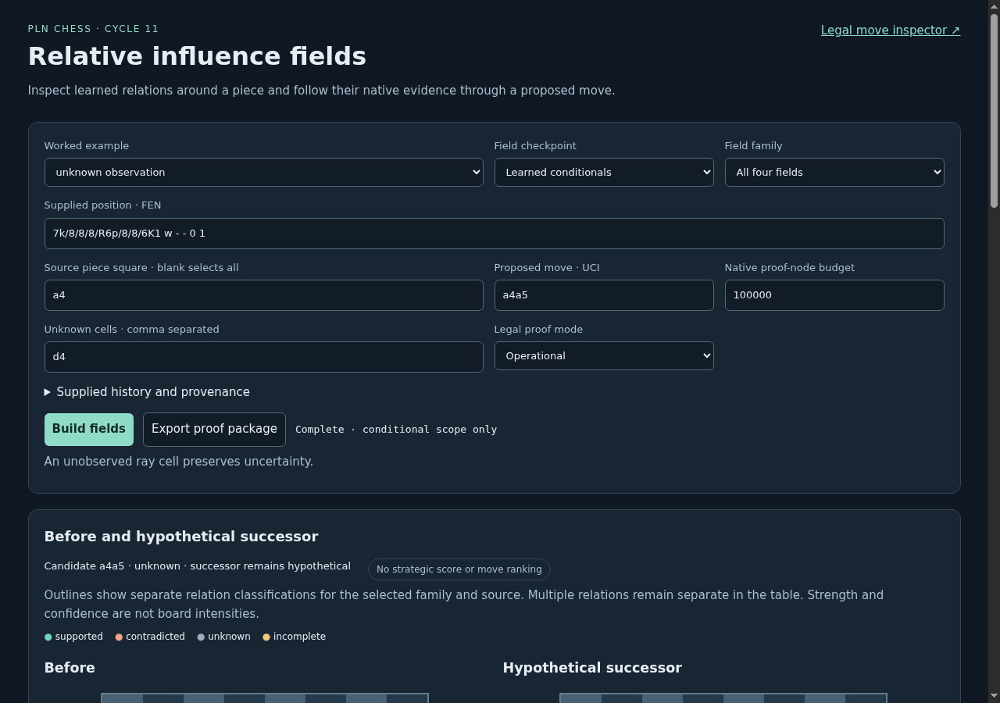

# ProofShot Verification Report

**Date:** 2026-11-10 09:05:16
**Project:** pln-chess-cycle11-browser-development
**Dev Server:** exec /data/pln-chess-cycle6-delivery/.venv/bin/python /data/pln-chess-cycle11-browser-development/owned-server.py on localhost:18781

## What Was Verified

Cycle 11 field selection, hypothetical successors, typed differences, native proofs, unknowns, exports and desktop/mobile layouts

## Video Recording

Full session recording: [session.webm](./session.webm) (121s)

## Screenshots

## Console Errors

No console errors detected.

## Server Errors

No server errors detected.

## Environment
- Browser: Chromium (headless)
- Viewport: 1280x720
- Duration: 121 seconds
