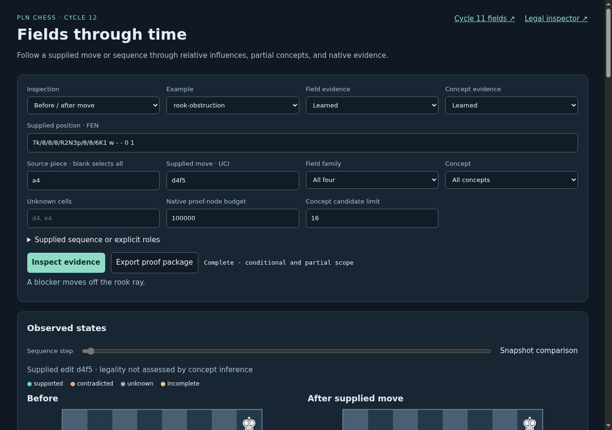
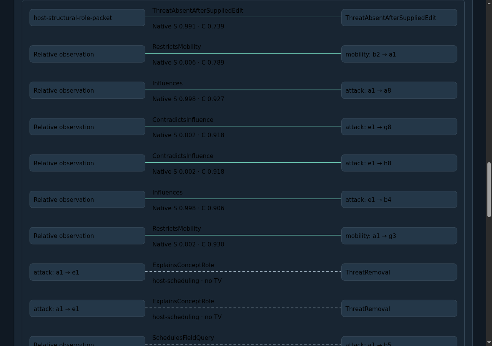
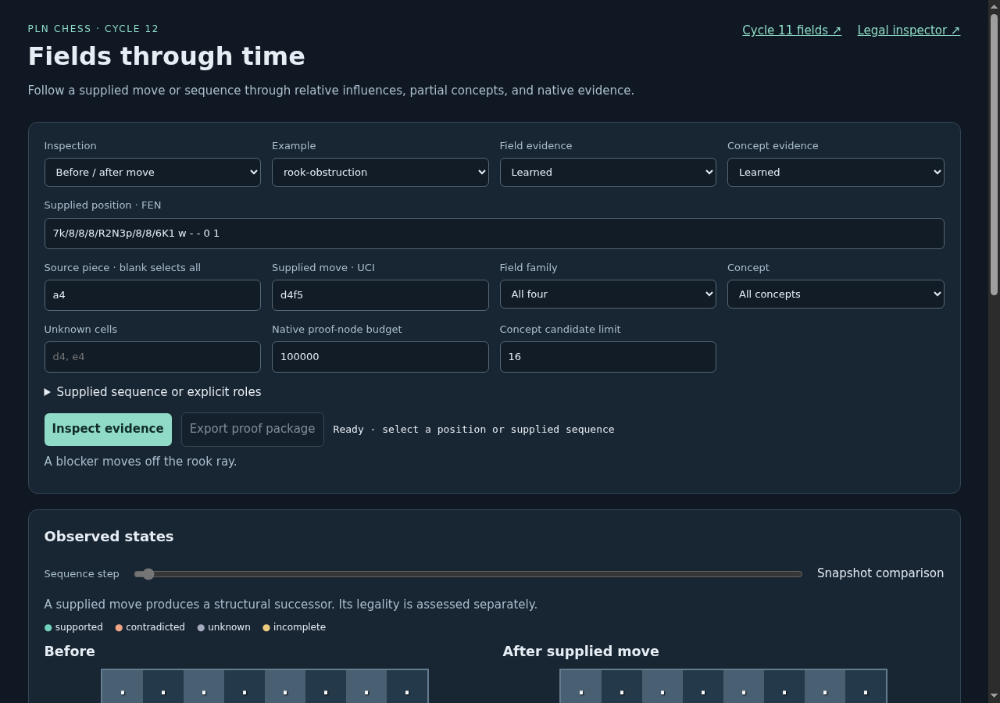
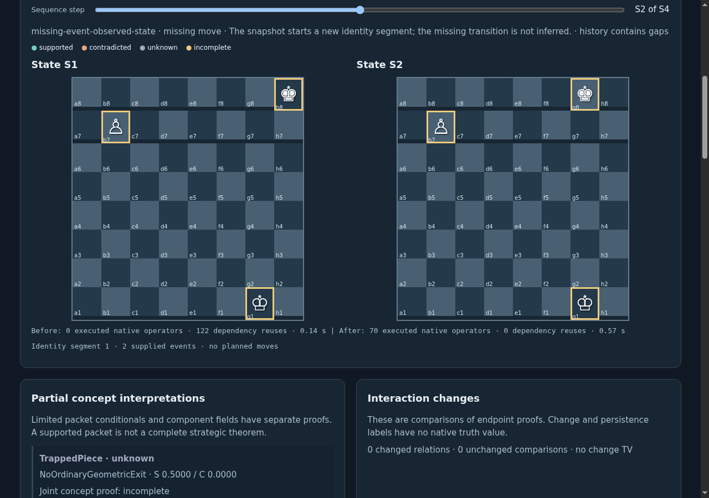
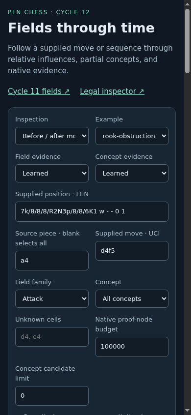
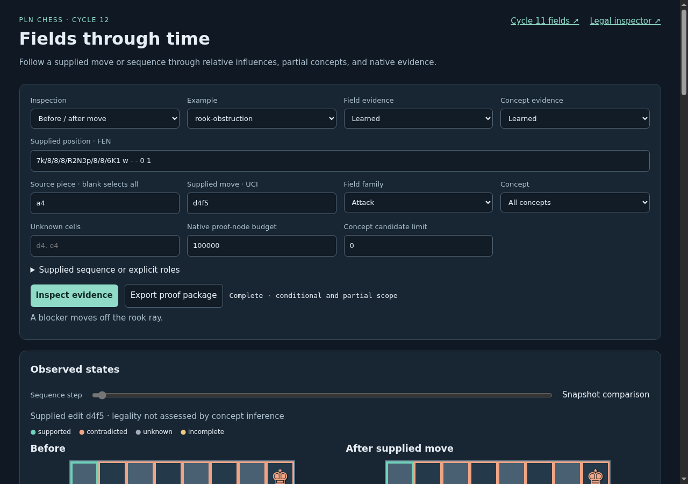
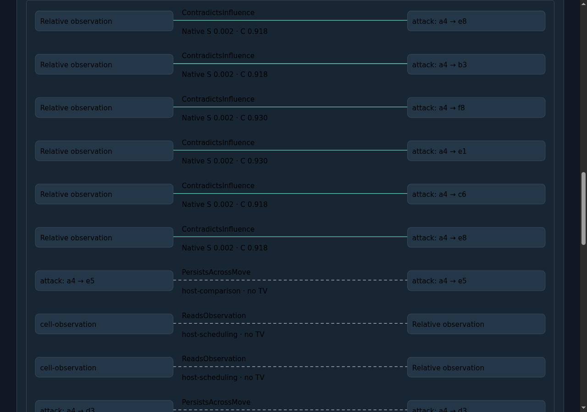
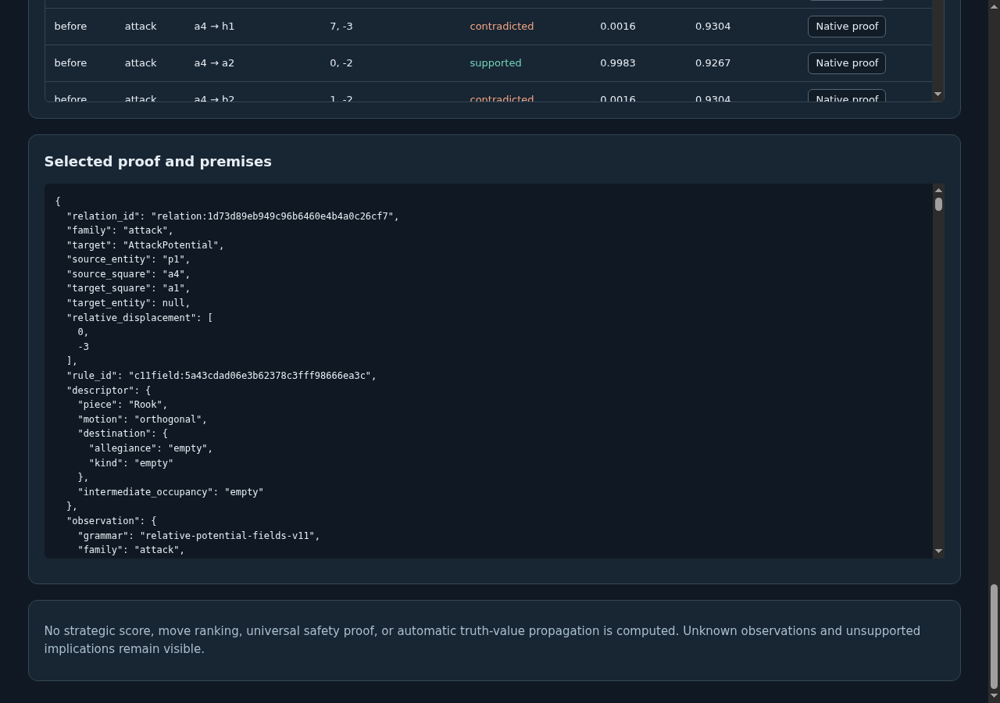
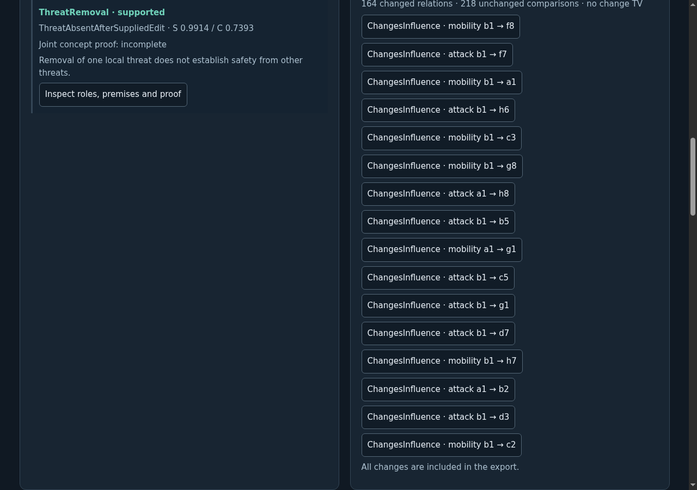
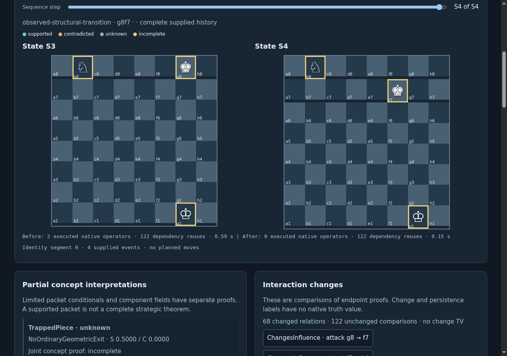

# ProofShot Verification Report

**Date:** 2026-11-10 15:49:16
**Project:** pln-chess-cycle12-ui-development
**Dev Server:** exec /data/pln-chess-cycle6-delivery/.venv/bin/python /data/pln-chess-cycle12-ui-development/owned-server.py on localhost:18782

## What Was Verified

Cycle 12 concept selection, dependency graph, supplied sequence steps, gaps, native proofs, exports and desktop/mobile layouts

## Video Recording

Full session recording: [session.webm](./session.webm) (465s)

## Screenshots

## Console Errors

No console errors detected.

## Server Errors

No server errors detected.

## Environment
- Browser: Chromium (headless)
- Viewport: 1280x720
- Duration: 465 seconds
