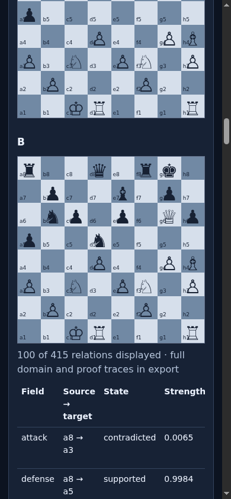
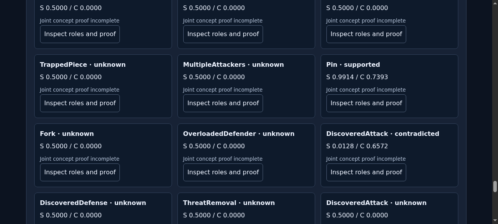

# ProofShot Verification Report

**Date:** 2026-11-11 02:35:30
**Project:** pln-chess-cycle6-delivery
**Dev Server:** .venv/bin/pln-chess serve --port 8773 on localhost:8773

## What Was Verified

Verify original-response proof export with exact native graph identities, plus responsive inspector controls

## Video Recording

Full session recording: [session.webm](./session.webm) (107s)

## Screenshots

## Console Errors

No console errors detected.

## Server Errors

No server errors detected.

## Environment
- Browser: Chromium (headless)
- Viewport: 1280x720
- Duration: 107 seconds
