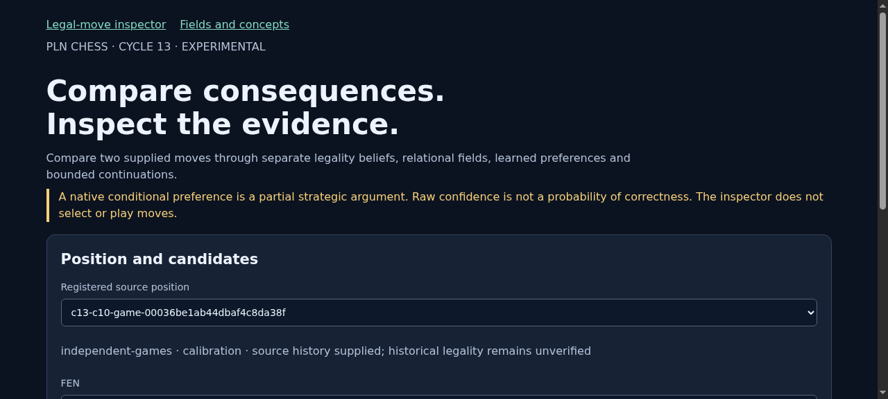
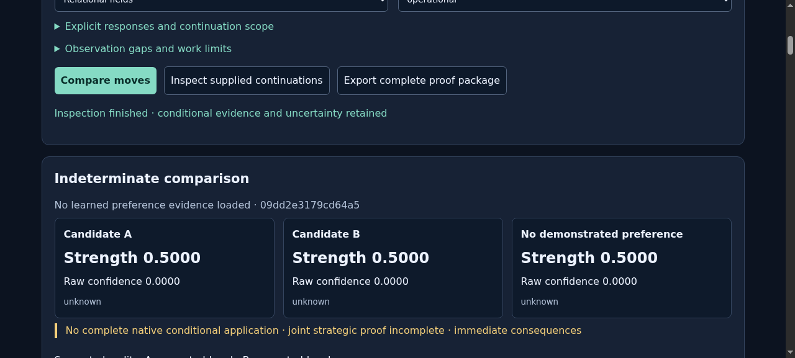
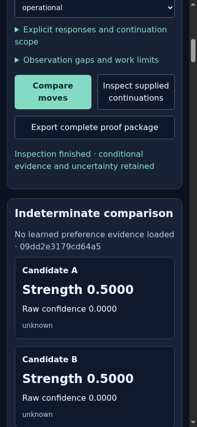
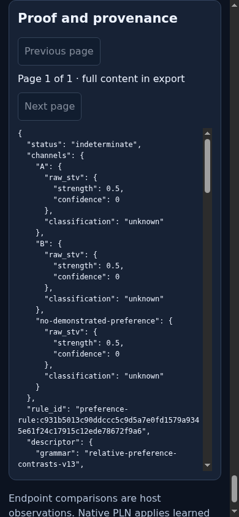
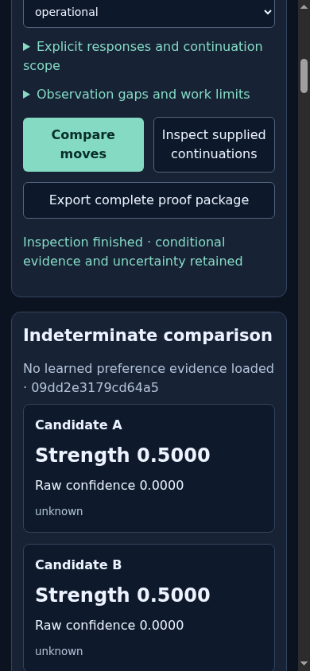

# ProofShot Verification Report

**Date:** 2026-11-11 02:27:54
**Project:** browser-initial
**Dev Server:** .venv/bin/pln-chess serve --port 8773 on localhost:8773

## What Was Verified

Cycle 13 isolated browser verification: desktop/mobile, live comparison, native proofs, complete export and explicit continuations

## Video Recording

Full session recording: [session.webm](./session.webm) (414s)

## Screenshots

## Console Errors

No console errors detected.

## Server Errors

No server errors detected.

## Environment
- Browser: Chromium (headless)
- Viewport: 1280x720
- Duration: 414 seconds
