# ProofShot Verification Report

**Date:** 2026-11-05 22:08:30
**Project:** pln-chess-cycle6-proof-control
**Dev Server:** TMPDIR=/dev/shm PYTHONDONTWRITEBYTECODE=1 C6_OUT=/data/pln-chess-cycle6-work /home/purplezky/work/takopi/pln-chess/.venv/bin/python -m pln_chess serve --port 8766 --checkpoint /data/pln-chess-cycle6-work/model/C6-full.json on localhost:8766

## What Was Verified

Committed Cycle 6 UI: mode table, stale-result clearing, raw evidence, budget, export and mobile layout

## Video Recording

Full session recording: [session.webm](./session.webm) (830s)

## Screenshots

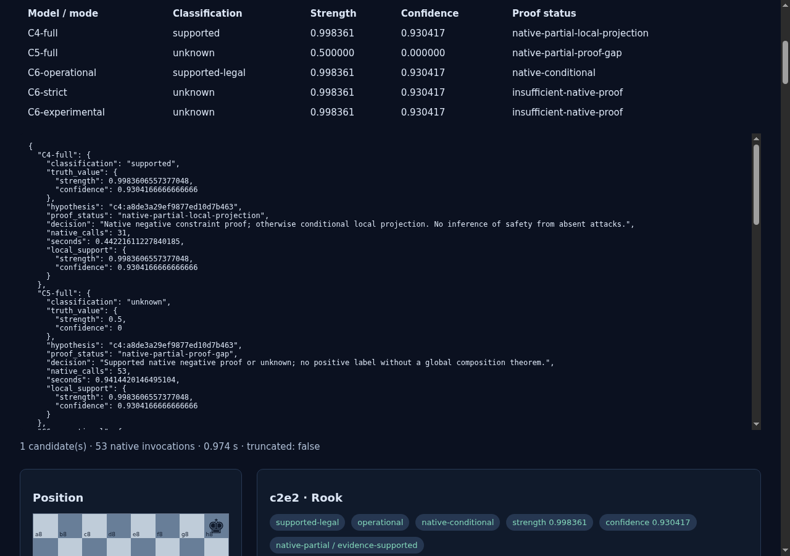

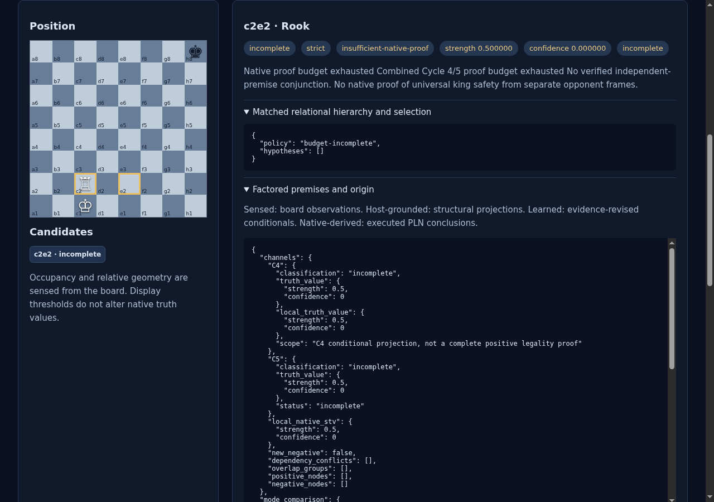

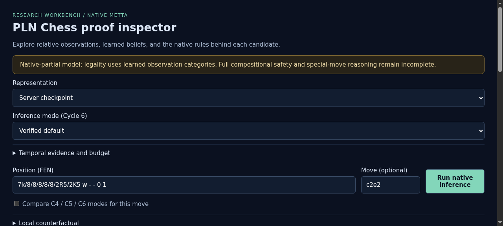

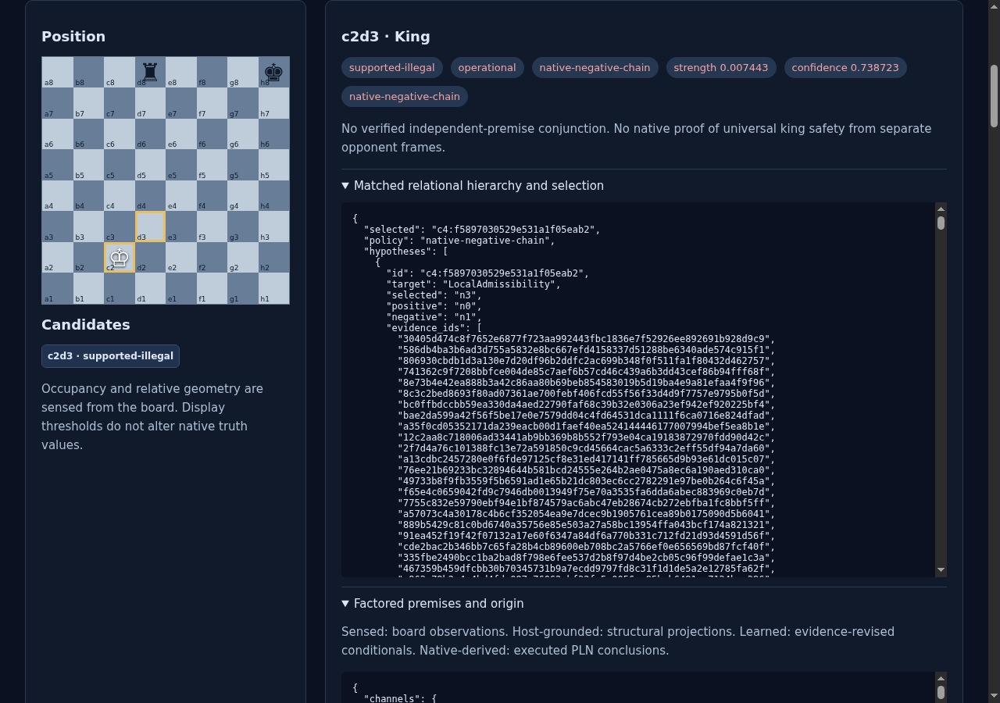

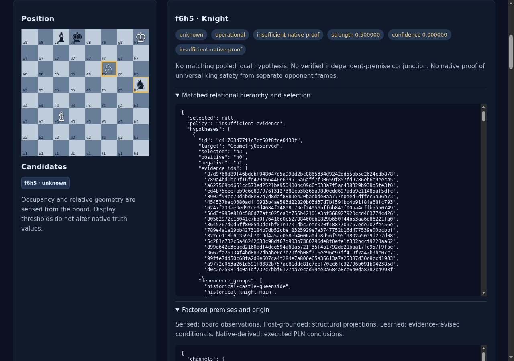

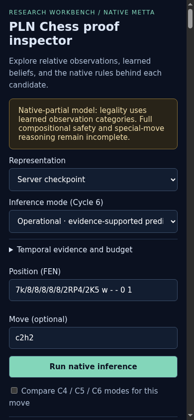

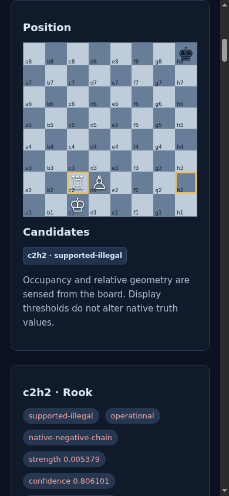

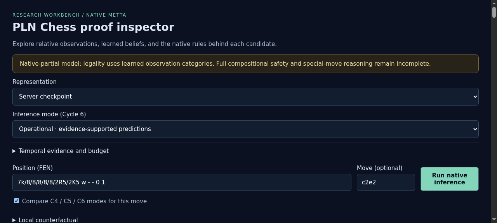

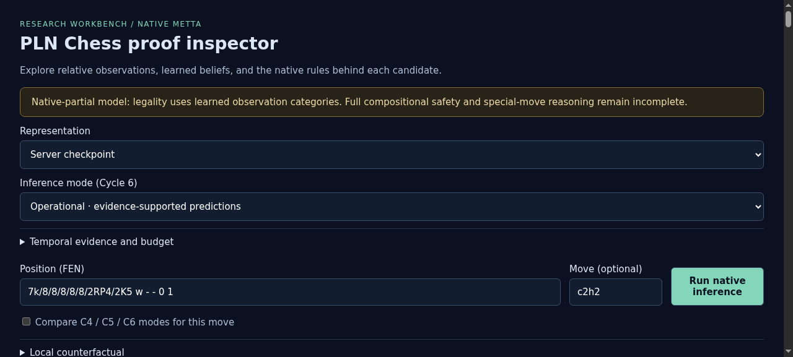

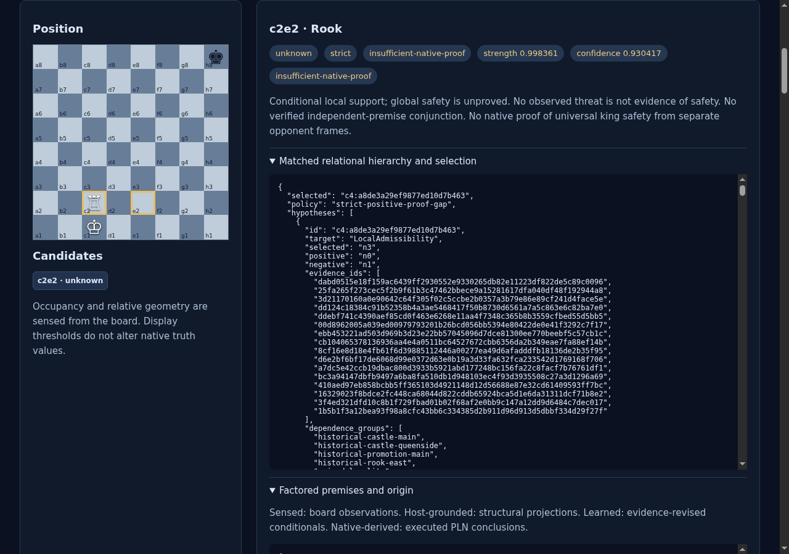

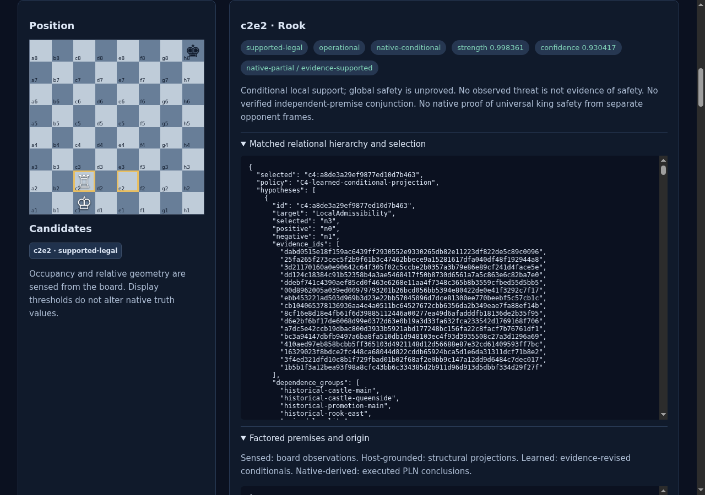

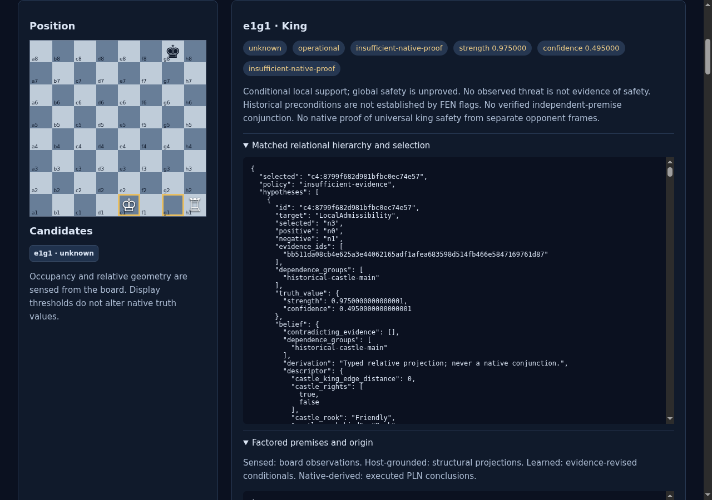

## Console Errors

No console errors detected.

## Server Errors

No server errors detected.

## Environment
- Browser: Chromium (headless)
- Viewport: 1280x720
- Duration: 830 seconds
