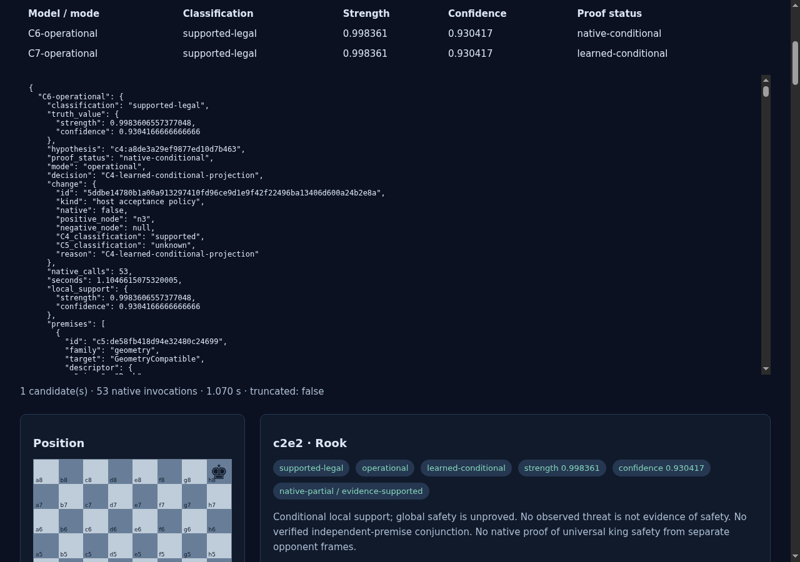
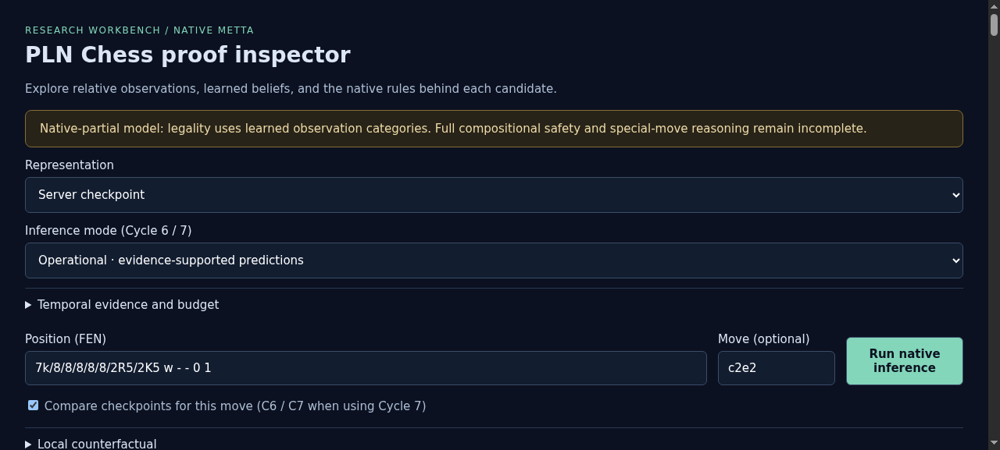
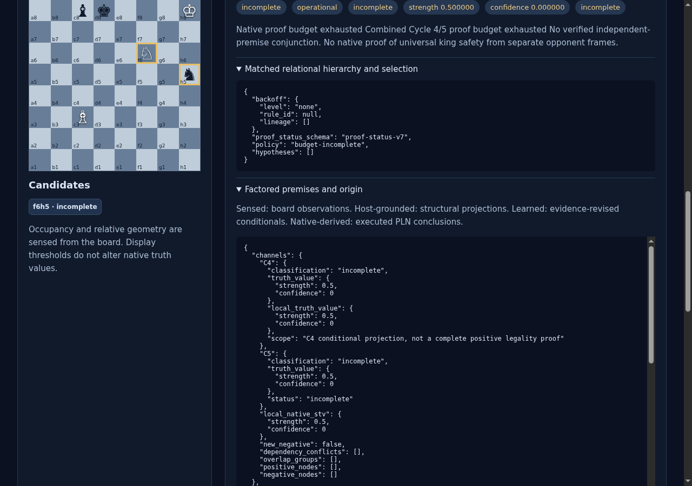
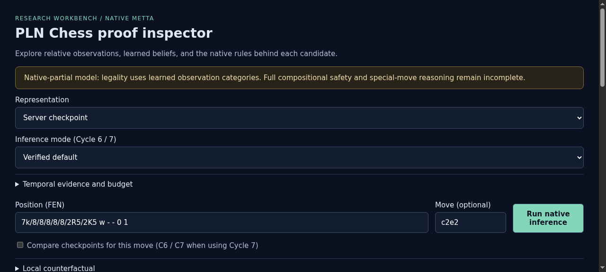
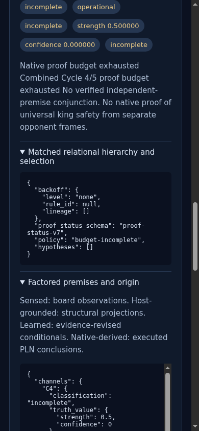
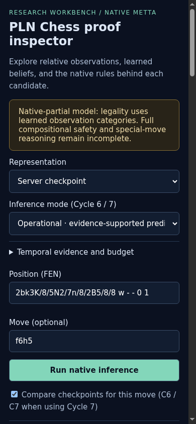
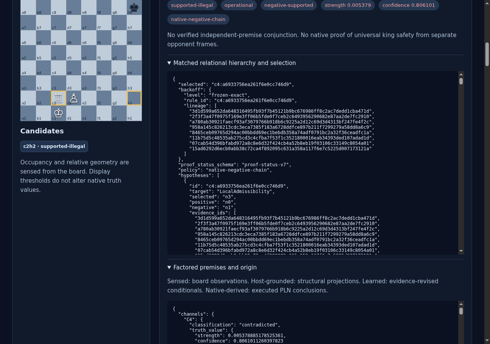
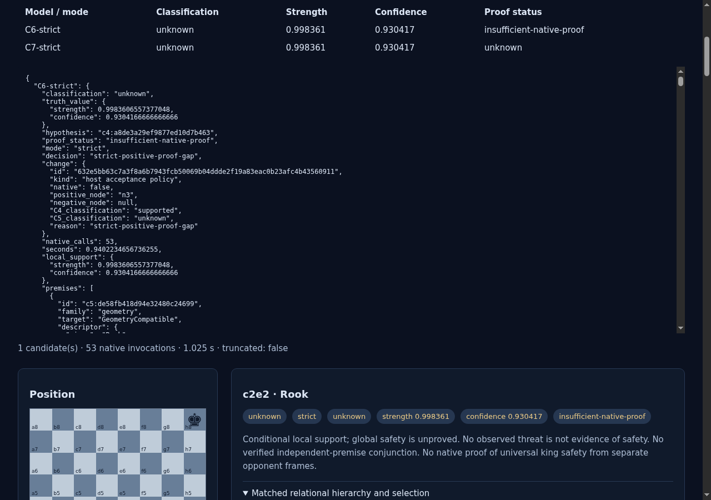

# ProofShot Verification Report

**Date:** 2026-11-07 10:38:24
**Project:** browser-harness
**Dev Server:** cd /home/purplezky/work/takopi/pln-chess && C7_OUT=/data/pln-chess-cycle7-work .venv/bin/python -m pln_chess serve --port 8767 --checkpoint /data/pln-chess-cycle7-work/model/C7-frozen.json on localhost:8767

## What Was Verified

Cycle 7 native proof categories, comparisons, modes and diagnostic exports in an isolated browser

## Video Recording

Full session recording: [session.webm](./session.webm) (428s)

## Screenshots

## Console Errors

No console errors detected.

## Server Errors

No server errors detected.

## Environment
- Browser: Chromium (headless)
- Viewport: 1280x720
- Duration: 428 seconds
