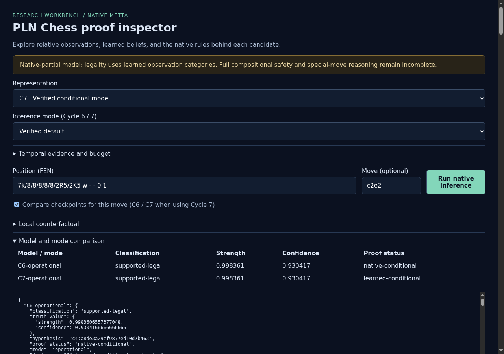
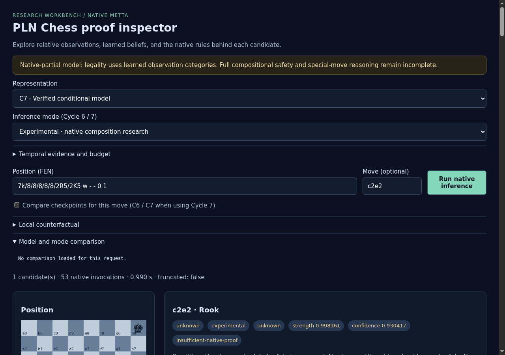
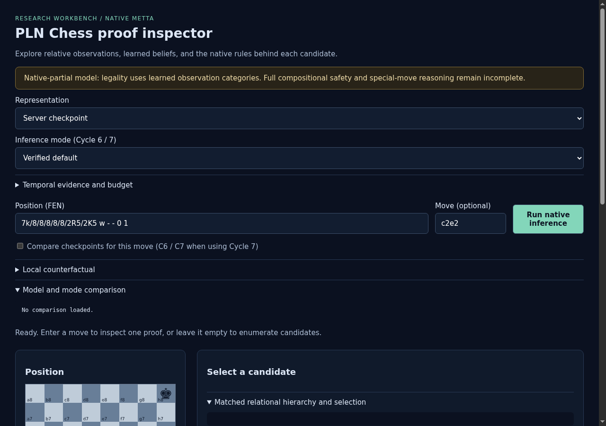
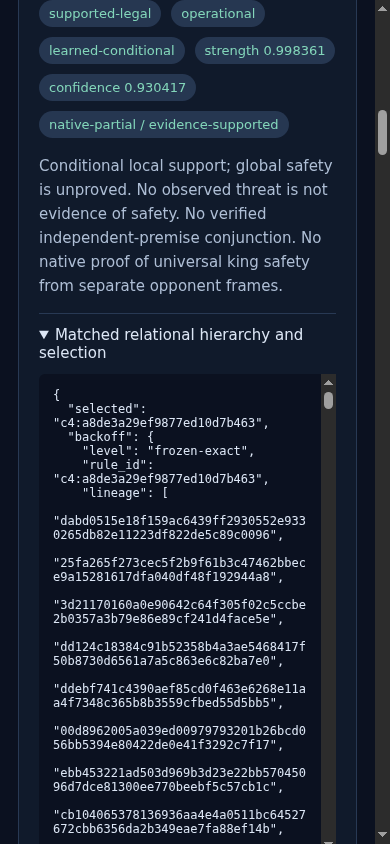
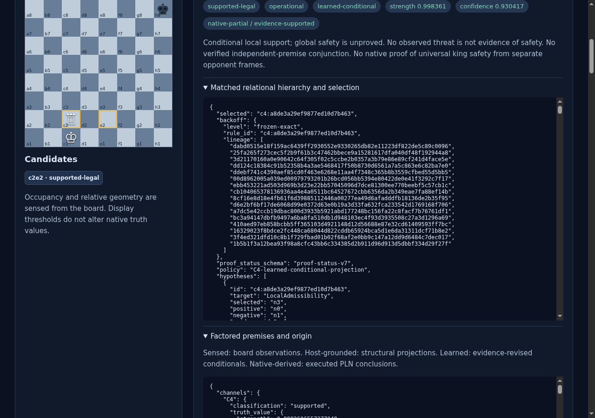
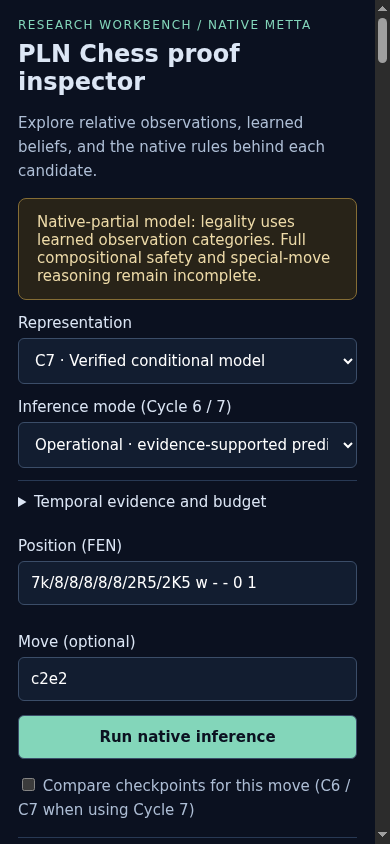
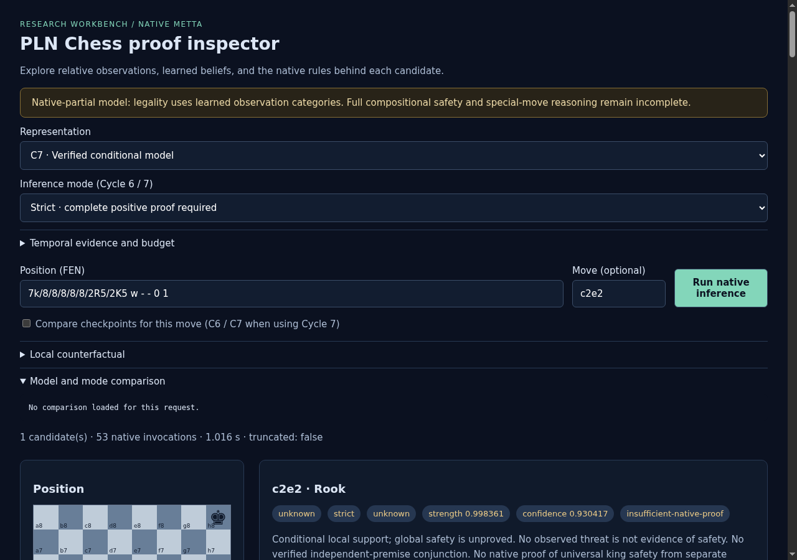

# ProofShot Verification Report

**Date:** 2026-11-07 12:42:40
**Project:** pln-chess-cycle7-final-browser
**Dev Server:** cd /home/purplezky/work/takopi/pln-chess && env -u C7_OUT -u C6_OUT TMPDIR=/dev/shm .venv/bin/python -m pln_chess serve --port 8768 on localhost:8768

## What Was Verified

Accepted packaged Cycle 7 default, C6/C7 comparison exports, strict and experimental abstention, negatives and mobile layout

## Video Recording

Full session recording: [session.webm](./session.webm) (314s)

## Screenshots

## Console Errors

No console errors detected.

## Server Errors

No server errors detected.

## Environment
- Browser: Chromium (headless)
- Viewport: 1280x720
- Duration: 314 seconds
