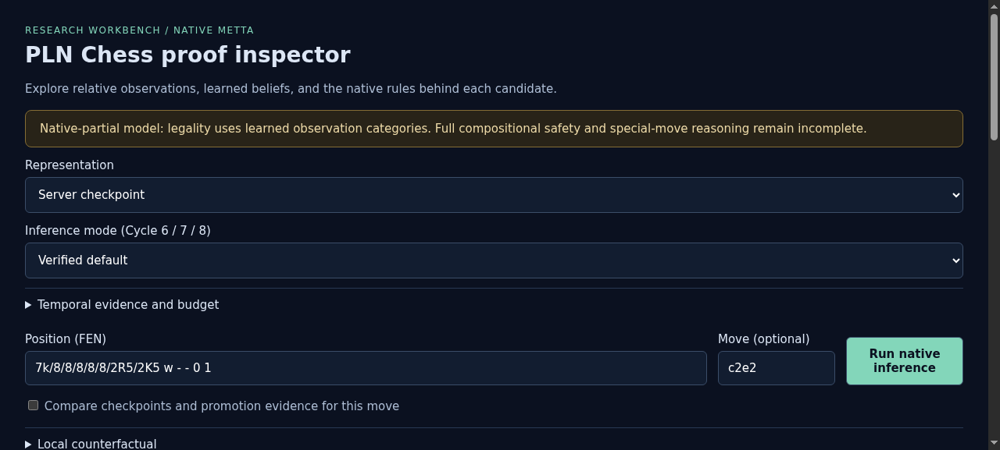
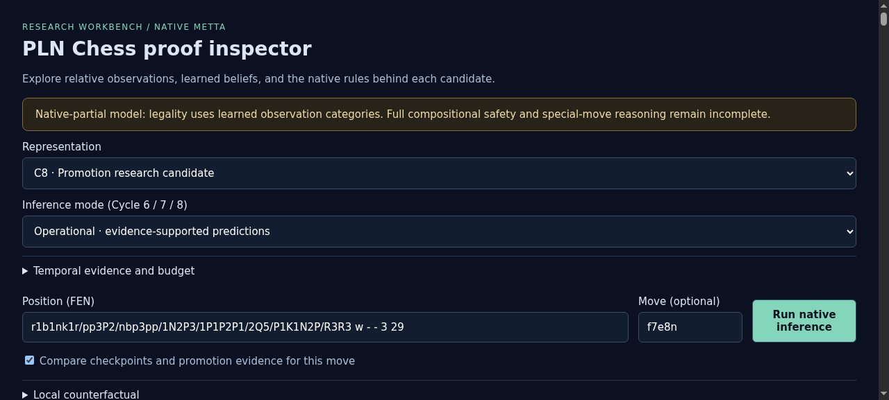
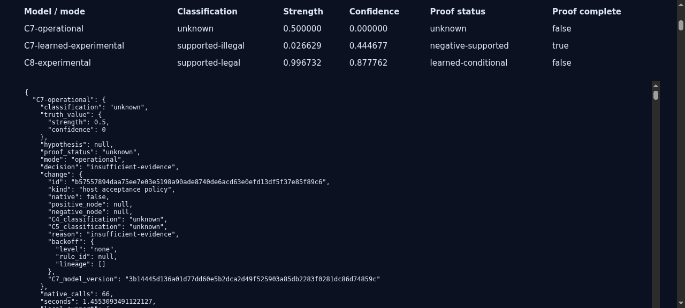
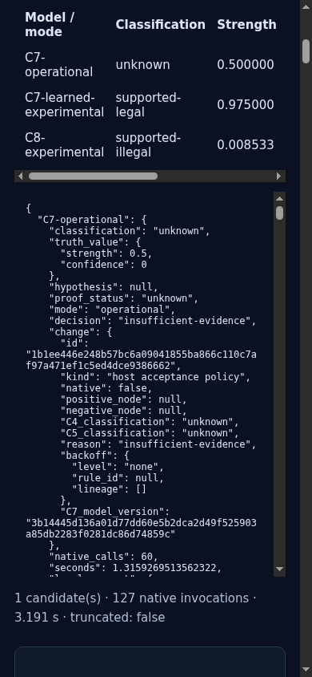

# ProofShot Verification Report

**Date:** 2026-11-08 00:46:41
**Project:** pln-chess-cycle8-ui-pilot
**Dev Server:** C8_OUT=/data/pln-chess-cycle8-work TMPDIR=/dev/shm /home/purplezky/work/takopi/pln-chess/.venv/bin/python -m pln_chess serve --checkpoint /data/pln-chess-cycle8-work/model/C8-promotion-relative.json --port 18768 on localhost:18768

## What Was Verified

Cycle 8 pilot: promotion comparison, proof completeness, export and mobile layout

## Video Recording

Full session recording: [session.webm](./session.webm) (130s)

## Screenshots

## Console Errors

No console errors detected.

## Server Errors

No server errors detected.

## Environment
- Browser: Chromium (headless)
- Viewport: 1280x720
- Duration: 130 seconds
