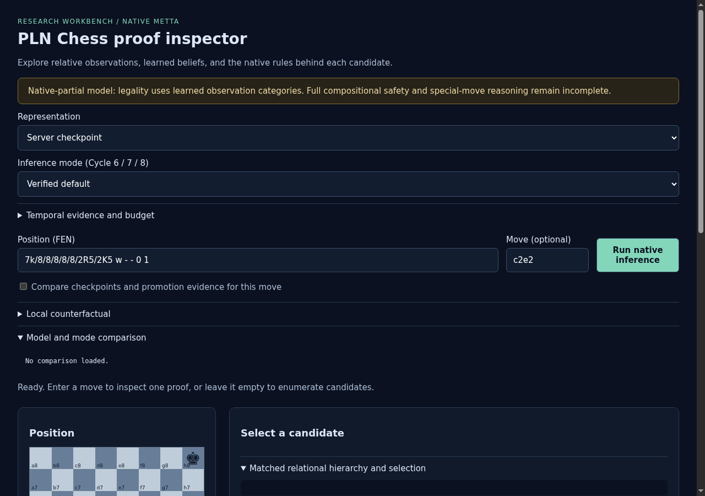
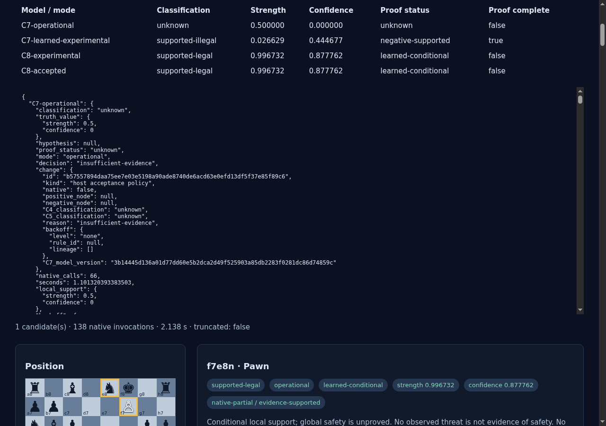
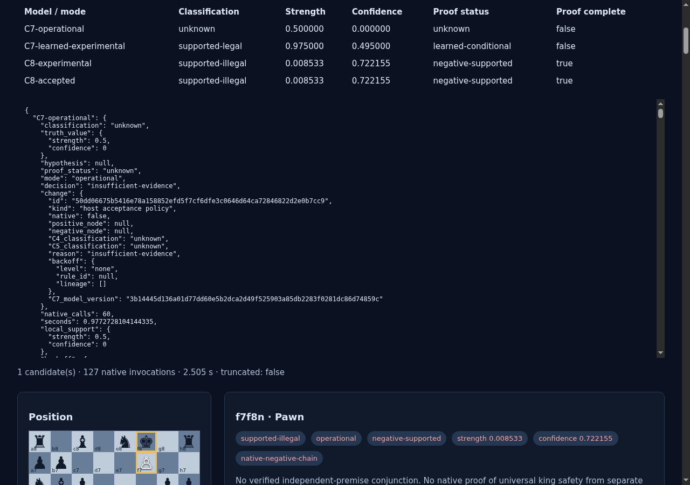
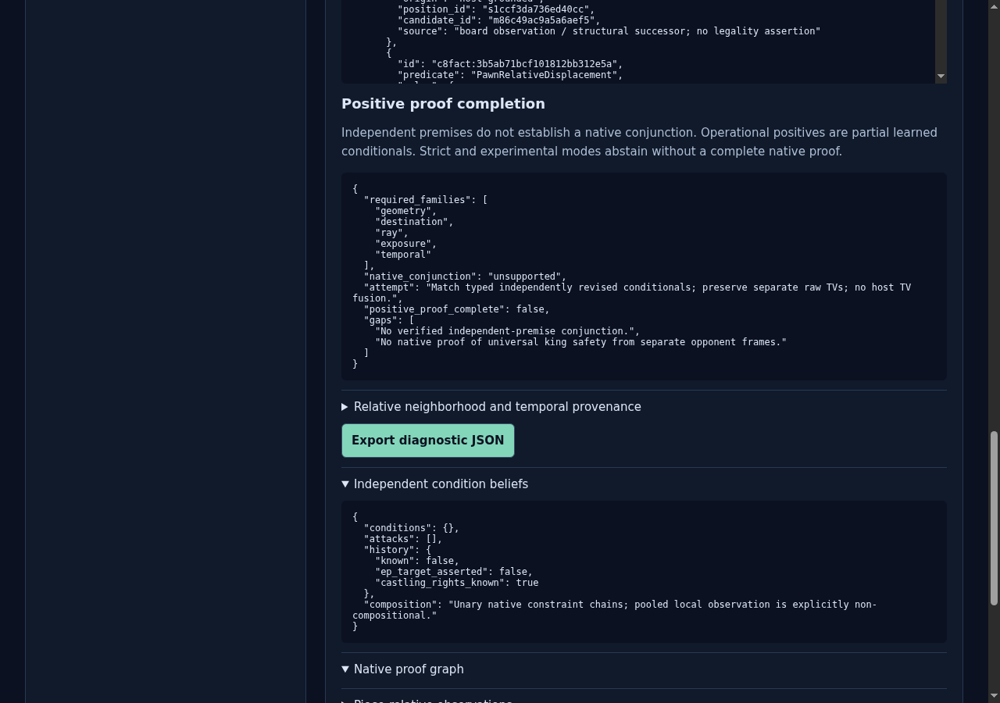
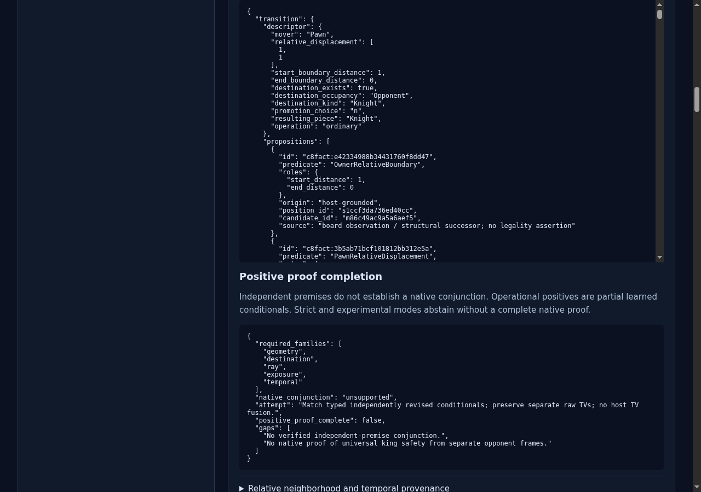

# ProofShot Verification Report

**Date:** 2026-11-08 03:37:29
**Project:** pln-chess-cycle8-ui-final
**Dev Server:** exec /data/pln-chess-cycle6-delivery/.venv/bin/python /data/pln-chess-cycle8-ui-final/owned-server.py on localhost:18769

## What Was Verified

Cycle 8 accepted default, all eight promotion comparisons, modes, budget, export and mobile layout

## Video Recording

Full session recording: [session.webm](./session.webm) (120s)

## Screenshots

## Console Errors

No console errors detected.

## Server Errors

No server errors detected.

## Environment
- Browser: Chromium (headless)
- Viewport: 1280x720
- Duration: 120 seconds
