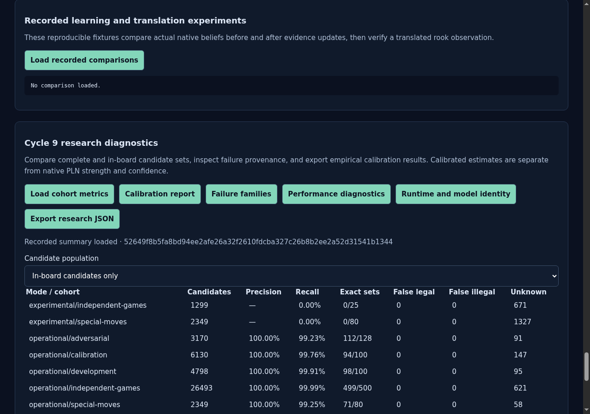
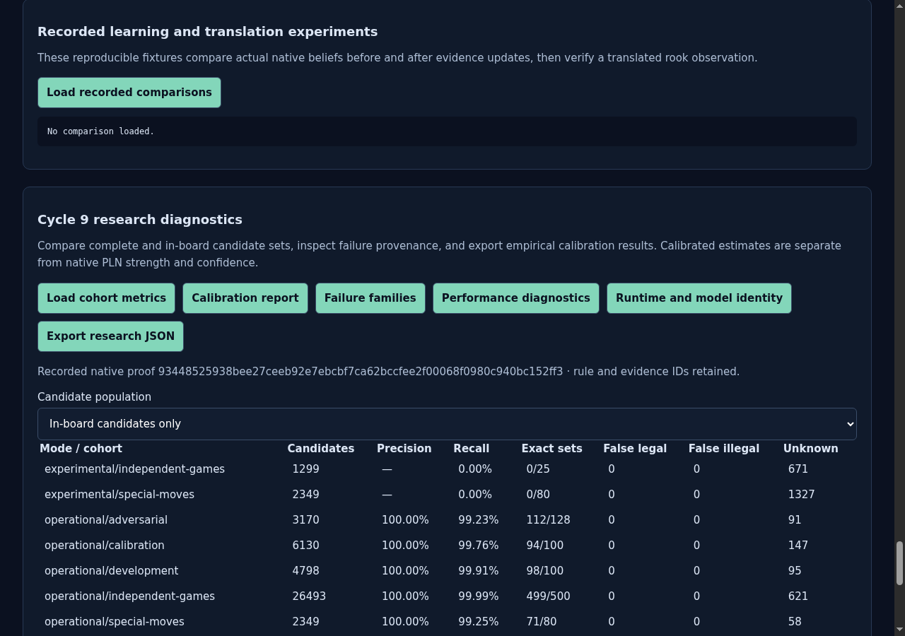
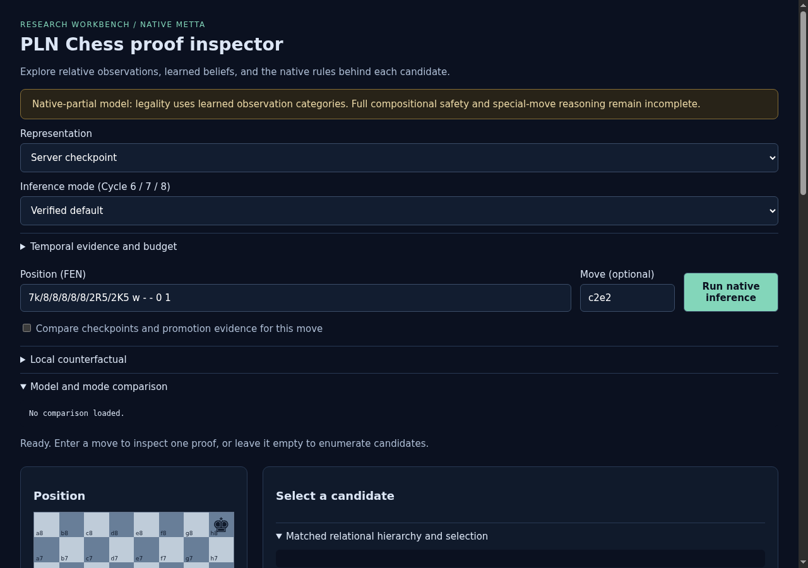
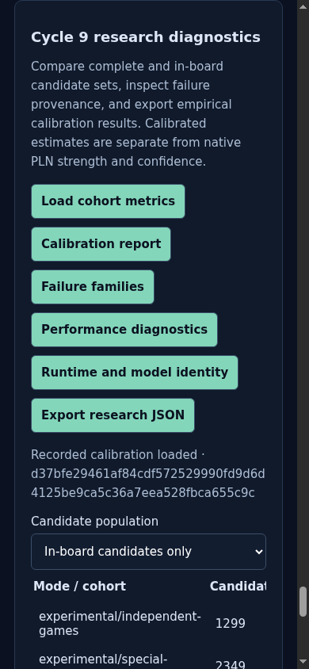
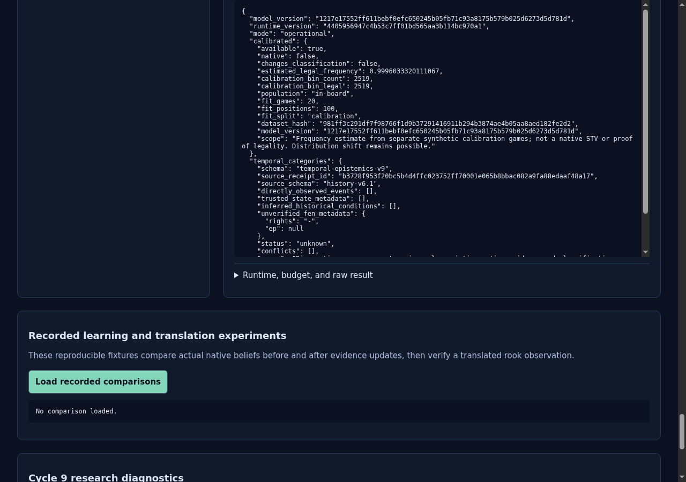
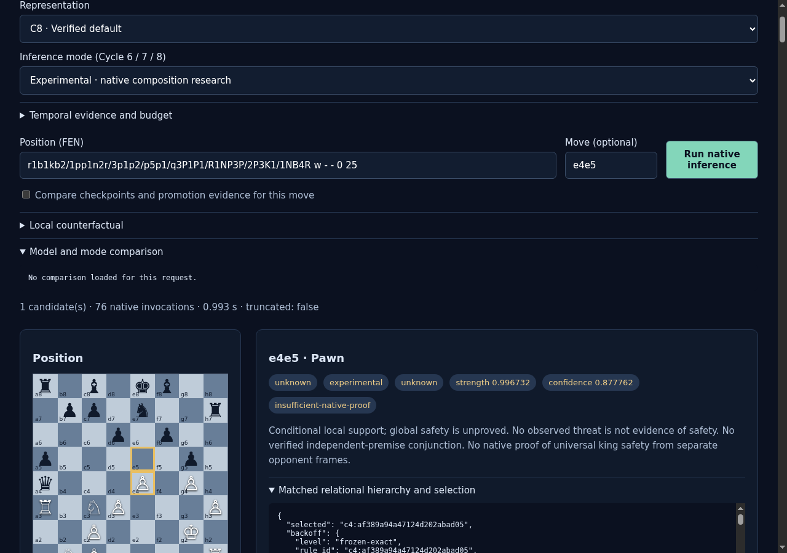

# ProofShot Verification Report

**Date:** 2026-11-09 15:34:41
**Project:** pln-chess-cycle9-browser
**Dev Server:** exec /data/pln-chess-cycle6-delivery/.venv/bin/python /data/pln-chess-cycle9-browser/owned-server.py on localhost:18779

## What Was Verified

Cycle 9 accepted model, calibrated diagnostics, failure provenance, report export, temporal categories and mobile layout

## Video Recording

Full session recording: [session.webm](./session.webm) (50s)

## Screenshots

## Console Errors

No console errors detected.

## Server Errors

No server errors detected.

## Environment
- Browser: Chromium (headless)
- Viewport: 1280x720
- Duration: 50 seconds
