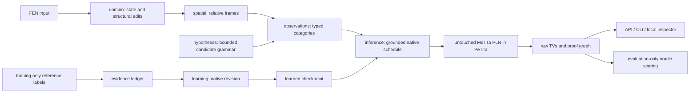

# Architecture

The project separates observation, native inference, evidence, and the reference oracle. Production code is under `src/pln_chess/`; `training/` and `evaluation/` are development packages imported lazily only by their explicit CLI commands.

`domain/` parses FEN and applies structural edits without legality checks. `spatial/` provides offsets, rays, orientation and explicit transform rejection when state semantics would change. `hypotheses/` seeds geometric candidate families, retaining illegal and boundary candidates. `observations/` records occupancy sequences and all opponent-to-king relative frames without testing attack geometry.

A context key hashes a readable typed descriptor containing piece, relative displacement, occupancy, local edge/start context, structural special-move metadata, and post-move opponent frames. The descriptor remains in checkpoints and traces. Hashing does not hide coordinates: tests inspect the preimage. Keys contain neither square names nor observation IDs. These categorical templates are an explicit inductive bias and can be very specific to relational configurations.

`pln/` verifies source hashes and runtime version, invokes PeTTa as a bounded subprocess, and validates the returned native STVs. There is no Python formula fallback. `inference/` schedules native ground operator calls, materializes each result once, and records premises, conclusion, native expression, hypothesis IDs and lineage. This is inference control, not a replacement calculus. Any native error/timeout yields `incomplete` and an actionable error. Native choice is used when alternatives share evidence; the application never revises those alternatives together.

The legality case has two separately observed conditional channels: context → LegalMove and context → Not(LegalMove). Both receive complementary observations with shared lineage. Native MP, native negation elimination, and native confidence choice produce a raw LegalMove TV. Attack observations independently produce Attack, followed by weak seeded implications Attack → WouldExposeOwnKing → Not(LegalMove). Native choice compares this counterevidence with the context result. There is no Boolean king-safety veto. A positive safe-king theorem is not inferred from missing attack support.

`evidence/` is an append-only JSONL store with locked/fsynced writes, content-derived evidence IDs, idempotency keys, timestamps and sequence validation. `learning/` deterministically replays it through native revision; checkpoints have content hashes and exact runtime/grammar versions. Rollback replays through a sequence into a new checkpoint; it never deletes ledger records.

The API exposes infer, explain, observe, train, import/export, hypothesis inspection, and transform comparison. Results carry raw TVs, evidence, model/runtime IDs, budgets and truncation. The loopback inspector renders these exact outputs. It contains no independent move logic.

Static import/call checks plus a test that disables oracle imports protect the production boundary. These checks cannot prove arbitrary semantic properties of every possible future edit; manual review of the compact observation/scheduler code remains appropriate.

## Cycle 5 scope

The earlier-cycle description above is preserved. See the [Cycle 5 update](cycle5/architecture.md) for strict positive proof gaps, typed native negative chains, temporal trust modes and measured coverage loss. No universal correctness or completed positive conjunction is claimed.
