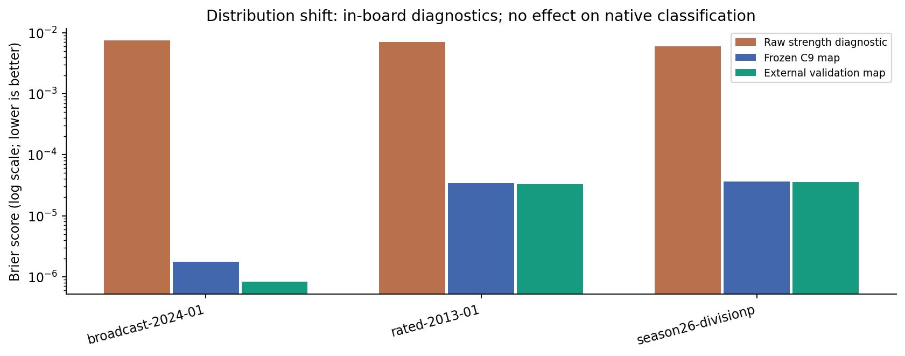

# Calibration and evidence dependence under shift

The unchanged Cycle 9 empirical map was evaluated on every frozen operational candidate before refitting. The external map then used only 144 positions from 24 calibration games; the 1,020-position final test never chose bins, hypotheses, inference thresholds or a promoted model. Calibration remains diagnostic. [calibration/frozen-evaluation.json](../../artifacts/cycle10/calibration/frozen-evaluation.json); [calibration/results.json](../../artifacts/cycle10/calibration/results.json)

| Population / cohort | Diagnostic | Candidates | Brier | ECE | Log loss |
|---|---|---|---|---|---|
| complete/Cycle9-reproduced/adversarial | external-validation-fit | 5504 | 0.0014388114 | 0.0014228754 | 0.0078234545 |
| complete/Cycle9-reproduced/adversarial | frozen-C9 | 5504 | 0.0014327017 | 0.0014214131 | 0.0074402596 |
| complete/Cycle9-reproduced/adversarial | raw-strength | 5504 | 0.0038126936 | 0.0098693959 | 0.014257198 |
| complete/Cycle9-reproduced/independent-games | external-validation-fit | 50127 | 3.0728616e-07 | 0.00014212946 | 0.00014228362 |
| complete/Cycle9-reproduced/independent-games | frozen-C9 | 50127 | 6.5705203e-07 | 0.00026166132 | 0.00026199137 |
| complete/Cycle9-reproduced/independent-games | raw-strength | 50127 | 0.0027919337 | 0.010146906 | 0.012289599 |
| complete/Cycle9-reproduced/special-moves | external-validation-fit | 3200 | 0.0012373422 | 0.0012369551 | 0.0067356699 |
| complete/Cycle9-reproduced/special-moves | frozen-C9 | 3200 | 0.0012320543 | 0.0012426994 | 0.006418591 |
| complete/Cycle9-reproduced/special-moves | raw-strength | 3200 | 0.0030033518 | 0.011145036 | 0.014685546 |
| complete/external-adaptation | external-validation-fit | 24069 | 4.1446938e-07 | 0.00015505616 | 0.0001552641 |
| complete/external-adaptation | frozen-C9 | 24069 | 8.7504437e-07 | 0.0002771004 | 0.00027754002 |
| complete/external-adaptation | raw-strength | 24069 | 0.0037929942 | 0.01208341 | 0.015002255 |
| complete/external-calibration | external-validation-fit | 25754 | 3.8836667e-05 | 0.00011606365 | 0.00035914047 |
| complete/external-calibration | frozen-C9 | 25754 | 3.9117807e-05 | 0.00023822541 | 0.00046737759 |
| complete/external-calibration | raw-strength | 25754 | 0.0037594638 | 0.011881005 | 0.014813242 |
| complete/external-history-sensitive-FEN-only | external-validation-fit | 2042 | 0.00097038622 | 0.00074598222 | 0.0054285597 |
| complete/external-history-sensitive-FEN-only | frozen-C9 | 2042 | 0.00096716108 | 0.00061884859 | 0.0052439922 |
| complete/external-history-sensitive-FEN-only | raw-strength | 2042 | 0.01057115 | 0.030723443 | 0.039826084 |
| complete/external-test | external-validation-fit | 172589 | 1.1858859e-05 | 0.00013939717 | 0.00021207639 |
| complete/external-test | frozen-C9 | 172589 | 1.2242118e-05 | 0.00025985948 | 0.00032853356 |
| complete/external-test | raw-strength | 172589 | 0.0035758934 | 0.011653244 | 0.014415679 |
| complete/external-test/lichess-broadcast-2024-01 | external-validation-fit | 59777 | 4.25942e-07 | 0.00015721606 | 0.00015742976 |
| complete/external-test/lichess-broadcast-2024-01 | frozen-C9 | 59777 | 8.9870542e-07 | 0.00028017345 | 0.00028062495 |
| complete/external-test/lichess-broadcast-2024-01 | raw-strength | 59777 | 0.0038989202 | 0.012269931 | 0.015270729 |
| complete/external-test/lichess-rated-2013-01 | external-validation-fit | 58617 | 1.7281368e-05 | 0.00013490312 | 0.0002418109 |
| complete/external-test/lichess-rated-2013-01 | frozen-C9 | 58617 | 1.7647773e-05 | 0.00025558782 | 0.00035649983 |
| complete/external-test/lichess-rated-2013-01 | raw-strength | 58617 | 0.0036480163 | 0.011783686 | 0.014607387 |
| complete/external-test/tcec-season26-divisionp | external-validation-fit | 54195 | 1.8604395e-05 | 0.00012460371 | 0.00024019088 |
| complete/external-test/tcec-season26-divisionp | frozen-C9 | 54195 | 1.8907159e-05 | 0.00024207341 | 0.00035112853 |
| complete/external-test/tcec-season26-divisionp | raw-strength | 54195 | 0.0031415876 | 0.010831954 | 0.01326521 |
| complete/synthetic-adversarial | external-validation-fit | 4976 | 0.0013925656 | 0.0013707839 | 0.0075761774 |
| complete/synthetic-adversarial | frozen-C9 | 4976 | 0.0013866716 | 0.0013644711 | 0.0072082734 |
| complete/synthetic-adversarial | raw-strength | 4976 | 0.0038574613 | 0.0099837639 | 0.014360346 |
| in-board/Cycle9-reproduced/adversarial | external-validation-fit | 3170 | 0.0024981786 | 0.0024819614 | 0.013572235 |
| in-board/Cycle9-reproduced/adversarial | frozen-C9 | 3170 | 0.0024875804 | 0.0024970656 | 0.012889265 |
| in-board/Cycle9-reproduced/adversarial | raw-strength | 3170 | 0.0066163759 | 0.015526445 | 0.023143126 |
| in-board/Cycle9-reproduced/independent-games | external-validation-fit | 26493 | 5.8642005e-07 | 0.00026624817 | 0.00026654235 |
| in-board/Cycle9-reproduced/independent-games | frozen-C9 | 26493 | 1.2684351e-06 | 0.00048502053 | 0.00048565765 |
| in-board/Cycle9-reproduced/independent-games | raw-strength | 26493 | 0.0052783119 | 0.017248632 | 0.021300654 |
| in-board/Cycle9-reproduced/special-moves | external-validation-fit | 2349 | 0.0016856143 | 0.0016663888 | 0.0091945761 |
| in-board/Cycle9-reproduced/special-moves | frozen-C9 | 2349 | 0.0016784333 | 0.0016525337 | 0.008784317 |
| in-board/Cycle9-reproduced/special-moves | raw-strength | 2349 | 0.0040896803 | 0.014390701 | 0.019213006 |
| in-board/external-adaptation | external-validation-fit | 12689 | 7.9235043e-07 | 0.0002979205 | 0.00029831801 |
| in-board/external-adaptation | frozen-C9 | 12689 | 1.6910492e-06 | 0.00053008774 | 0.00053093724 |
| in-board/external-adaptation | raw-strength | 12689 | 0.0071904162 | 0.020959724 | 0.02649416 |
| in-board/external-calibration | external-validation-fit | 13213 | 7.5703964e-05 | 0.00022621277 | 0.00070000667 |
| in-board/external-calibration | frozen-C9 | 13213 | 7.6275528e-05 | 0.00045999278 | 0.0009066574 |
| in-board/external-calibration | raw-strength | 13213 | 0.0073231891 | 0.021082851 | 0.026795923 |
| in-board/external-history-sensitive-FEN-only | external-validation-fit | 1594 | 0.0012431271 | 0.00090798493 | 0.0070019414 |
| in-board/external-history-sensitive-FEN-only | frozen-C9 | 1594 | 0.0012390373 | 0.00068692199 | 0.0068237192 |
| in-board/external-history-sensitive-FEN-only | raw-strength | 1594 | 0.01354087 | 0.038743981 | 0.050404282 |
| in-board/external-test | external-validation-fit | 90055 | 2.273334e-05 | 0.00026942552 | 0.00040871712 |
| in-board/external-test | frozen-C9 | 90055 | 2.3492285e-05 | 0.00049895884 | 0.00063058688 |
| in-board/external-test | raw-strength | 90055 | 0.0068487639 | 0.020329747 | 0.025621717 |
| in-board/external-test/lichess-broadcast-2024-01 | external-validation-fit | 31060 | 8.2577447e-07 | 0.00030455858 | 0.00030497286 |
| in-board/external-test/lichess-broadcast-2024-01 | frozen-C9 | 31060 | 1.7600661e-06 | 0.00053947236 | 0.00054035654 |
| in-board/external-test/lichess-broadcast-2024-01 | raw-strength | 31060 | 0.0074993082 | 0.021593106 | 0.027366124 |
| in-board/external-test/lichess-rated-2013-01 | external-validation-fit | 30550 | 3.3164252e-05 | 0.00026141295 | 0.00046654246 |
| in-board/external-test/lichess-rated-2013-01 | frozen-C9 | 30550 | 3.3891991e-05 | 0.0004920046 | 0.00068564225 |
| in-board/external-test/lichess-rated-2013-01 | raw-strength | 30550 | 0.0069951436 | 0.020601226 | 0.026016929 |
| in-board/external-test/tcec-season26-divisionp | external-validation-fit | 28445 | 3.5452083e-05 | 0.00023966813 | 0.00045989423 |
| in-board/external-test/tcec-season26-divisionp | frozen-C9 | 28445 | 3.6053076e-05 | 0.00046218972 | 0.00066998267 |
| in-board/external-test/tcec-season26-divisionp | raw-strength | 28445 | 0.0059812016 | 0.018658676 | 0.023292485 |
| in-board/synthetic-adversarial | external-validation-fit | 2816 | 0.0024607294 | 0.0024338115 | 0.013375877 |
| in-board/synthetic-adversarial | frozen-C9 | 2816 | 0.002450325 | 0.0024405885 | 0.012707847 |
| in-board/synthetic-adversarial | raw-strength | 2816 | 0.0068126437 | 0.015964938 | 0.023696722 |

Strength-bin reliability, confidence-bin legal frequencies, selective risk and coverage curves are included in the JSON. Native confidence is treated as a feature for association and abstention analysis, not automatically as an empirical probability. Overall Brier/coverage/recall uncertainty uses 400 game- or controlled-pair bootstrap draws; bin Wilson intervals are explicitly labelled naive because they ignore dependence. Log loss clips probabilities at 1e-12. [calibration/results.json](../../artifacts/cycle10/calibration/results.json)

The same analysis includes freshly reproduced original synthetic, adversarial and special-move cohorts and the external FEN-only history-sensitive candidates. The external mapping is displayed only for its frozen operational model, with a source-bound acceptance receipt and artifact hash; adapted, strict and incomplete outputs do not acquire an unsupported calibration claim. [Diagnostic interface](../../src/pln_chess/cycle10/diagnostics.py).

Dependence experiments preserve native Truth_Revision. A source game contributes at most one observation per hypothesis; the main policy also groups common opening ancestry. Rank-reflected/color-swapped copies retain ancestor groups. Contradictions within a game exclude that group; declared synthetic independent contradictions revise both native channels. [dependence/summary.json](../../artifacts/cycle10/dependence/summary.json)

Duplicates preserve native values: **True**. Transformed ancestor copies preserve native values: **True**. Unsafe row counting changes values: **True**. These are controlled experimental findings. The grouping policy assumes truthful provenance; unrelated game IDs cannot prove statistical independence. [dependence/summary.json](../../artifacts/cycle10/dependence/summary.json)

| Dependence variant | Observed records | Revised hypotheses | Excluded records | Native revision nodes |
|---|---|---|---|---|
| base | 16 | 16 | 0 | 32 |
| duplicates | 32 | 16 | 16 | 32 |
| game-only | 384 | 129 | 0 | 768 |
| independent-conflict | 17 | 16 | 0 | 34 |
| shared-conflict | 17 | 15 | 2 | 30 |
| transformed | 32 | 16 | 16 | 32 |
| unsafe | 32 | 16 | 0 | 64 |

| Prediction panel model | Recall | Coverage | False legal | False illegal | Checkpoint bytes |
|---|---|---|---|---|---|
| base | 99.1935% | 98.4182% | 0 | 0 | 2916318 |
| duplicates | 99.1935% | 98.4182% | 0 | 0 | 2916331 |
| frozen | 99.1935% | 98.3688% | 0 | 0 | 2905103 |
| game-only | 99.1935% | 98.4182% | 0 | 0 | 3078259 |
| independent-conflict | 99.1935% | 98.4182% | 0 | 0 | 2916563 |
| shared-conflict | 99.1935% | 98.4182% | 0 | 0 | 2915121 |
| transformed | 99.1935% | 98.4182% | 0 | 0 | 2916333 |
| unsafe | 99.1935% | 98.4182% | 0 | 0 | 2918420 |

The prediction panel is fixed at twelve held-out games, four per source, and is descriptive. Full final-test evaluation is reserved for the registered frozen/small/large comparison. Complete native values, confidence changes, model sizes, evidence lineage and proof artifacts remain available. [dependence/predictions.json](../../artifacts/cycle10/dependence/predictions.json)
