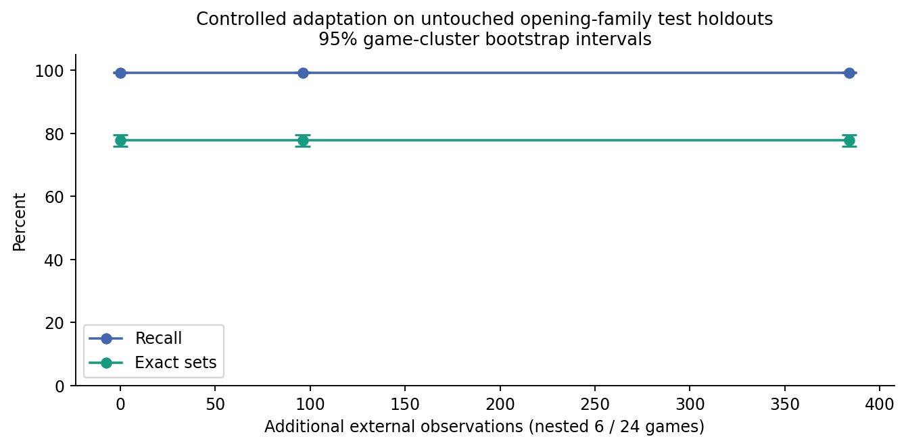

# Cycle 10 consolidated engineering report

Starting commit: `257473d2462c75f84d3975bb91d85a8c1cc269dd`. Verified implementation commit: `e940c4bffb8a3472ec86ee4441bfeec44ed0b88e`. Production source hash: `543ff722a518a8fe0165e2327be5ac62357e28040a15fd3a764d369297d1febc`. Accepted model remains `1217e17552ff611bebf0efc650245b05fb71c93a8175b579b025d6273d5d781d`. All changes and commits are local; this cycle authorizes no push or deployment. [verification.json](../../artifacts/cycle10/verification.json)

| Package | Work | Status | Evidence |
|---|---|---|---|
| C10-01 | Baseline reproduction | Complete | [baseline/reproduction-receipt.json](../../artifacts/cycle10/baseline/reproduction-receipt.json) |
| C10-02 | External source acquisition | Complete; three collections, two publishers | [sources/manifest.json](../../artifacts/cycle10/sources/manifest.json) |
| C10-03 | Independent corpus and overlap | Complete | [datasets/all-symmetry-audit.json](../../artifacts/cycle10/datasets/all-symmetry-audit.json) |
| C10-04 | Frozen external generalization | Complete; measured outcomes reported | [analysis/frozen-summary.json](../../artifacts/cycle10/analysis/frozen-summary.json) |
| C10-05 | Structural failure taxonomy | Complete census | [analysis/frozen-failure-index.json](../../artifacts/cycle10/analysis/frozen-failure-index.json) |
| C10-06 | Adversarial abstentions | Complete investigation; unresolved outcomes retained | [temporal/historical-abstentions.json.xz](../../artifacts/cycle10/temporal/historical-abstentions.json.xz) |
| C10-07 | Special moves | Complete investigation and controls | [temporal/counterfactuals.json.xz](../../artifacts/cycle10/temporal/counterfactuals.json.xz) |
| C10-08 | Temporal transport | Implemented and tested | [temporal/game-replay.json](../../artifacts/cycle10/temporal/game-replay.json) |
| C10-09 | Temporal counterfactuals | Complete | [temporal/summary.json](../../artifacts/cycle10/temporal/summary.json) |
| C10-10 | Calibration shift | Complete; diagnostic only | [calibration/results.json](../../artifacts/cycle10/calibration/results.json) |
| C10-11 | Evidence dependence | Complete controlled ablations | [dependence/predictions.json](../../artifacts/cycle10/dependence/predictions.json) |
| C10-12 | Controlled adaptation | Complete; no promotion | [adaptation/comparison.json](../../artifacts/cycle10/adaptation/comparison.json) |
| C10-13 | Performance and memory | Complete measurements; tail limits explicit | [performance/comparison.json](../../artifacts/cycle10/performance/comparison.json) |
| C10-14 | Strategic readiness | Design only, as authorized | [architecture/strategic-readiness.json](../../artifacts/cycle10/architecture/strategic-readiness.json) |
| C10-15 | Native boundary | Existing no-go retained | [architecture/decision.json](../../artifacts/cycle10/architecture/decision.json) |
| C10-16 | API, CLI and inspector | Implemented; desktop/mobile evidence | [ui/verification.json](../../artifacts/cycle10/ui/verification.json) |
| C10-17 | Acceptance and regression | Mandatory gates passed | [verification.json](../../artifacts/cycle10/verification.json) |
| C10-18 | Consolidated delivery | Reports, artifacts, local commits | [manifest.json](../../artifacts/cycle10/manifest.json) |

The original 365 tests, 26 established suites, 48 Cycle 9 shards and 287 negative controls were reproduced from unchanged original tracked source with exact native proof parity. The initial runtime symlink was reported as untracked; moving that same pinned link beneath an ignored directory restored a wholly clean checkout before frozen external inference. Original historical artifacts and configuration locks remain byte-identical. Fresh timing is reported as a new host measurement rather than claimed identical wall-clock reproduction. [baseline/reproduction-receipt.json](../../artifacts/cycle10/baseline/reproduction-receipt.json); [baseline/cohort-metrics.json](../../artifacts/cycle10/baseline/cohort-metrics.json); [baseline/proof-parity.json](../../artifacts/cycle10/baseline/proof-parity.json)

The independent corpus contains 1,308 external positions from 150 complete published records, with 1,020 final-test positions from 102 games, plus 112 separately labelled synthetic adversarial positions. Frozen final-test recall is 99.2645% and exact sets are 793/1020. Source and sampling limitations are explicit. [Provenance](dataset-provenance.md); [external results](external-generalization.md); [failure census](generalization-failures.md).

The temporal mechanism transports supplied history without inventing unavailable predecessors or claiming complete legal-play verification. Its controlled interventions explain historical abstentions, and actual PGN prefixes test independent transfer. [Temporal evidence](temporal-evidence.md).

Controlled adaptation used nested 6-game and 24-game subsets, with 16 unique relative observations per game selected before consulting labels. Learning uses native revision, exact relative descriptors and explicit source/game/opening lineage. Final-test games and opening families remain separate. No adapted model was promoted. [adaptation/summary.json](../../artifacts/cycle10/adaptation/summary.json); [adaptation/comparison.json](../../artifacts/cycle10/adaptation/comparison.json)

| Model | Additional observations | Games | Recall | Exact sets | False legal | False illegal |
|---|---|---|---|---|---|---|
| frozen | 0 | 0 | 99.2645% | 793/1020 | 0 | 0 |
| large | 384 | 24 | 99.2645% | 793/1020 | 0 | 0 |
| small | 96 | 6 | 99.2645% | 793/1020 | 0 | 0 |

| Research area | Target | Measured | Disposition |
|---|---|---|---|
| External collections | at least 3 | 3 collections / 2 publishers | Met; source dependence remains |
| Final external positions | at least 1,000 | 1020 | Met |
| Final source games | at least 100 | 102 | Met |
| Additional synthetic adversarial positions | at least 100 | 112 | Met |
| Additional adversarial exact sets | at least 95% | 87.5000% | Missed |
| Original adversarial exact sets, FEN only | at least 95% | 112/128 (87.5%) | Missed; unchanged evidence policy |
| Original special-move exact sets, FEN only | at least 95% | 71/80 (88.75%) | Missed; unchanged evidence policy |
| Established acceptance errors | zero new | 0 new false-legal / false-illegal / self-check false-positive | Passed |
| Negative evidence controls | 287/287 | 287/287 | Passed |
| Cold full-position latency | no detected regression | median ratio 1.0176644, interval [0.9806220552115736, 1.0358092533703176] | No detected slowdown; not proof of equivalence |
| Warm full-position latency | no detected regression | median ratio 0.99698263, interval [0.9536976485977572, 1.0528682079791492] | No detected slowdown; not proof of equivalence |

[research-targets.json](../../artifacts/cycle10/research-targets.json)

Experimental historical regression comprises 32 evaluations. It records 0 false-legal, 0 false-illegal and 0 self-check false-positive outcomes across those repeated suites. Counts include overlapping cohorts and must not be interpreted as independent error events. [adaptation/regression-summary.json](../../artifacts/cycle10/adaptation/regression-summary.json)

Any changed final-test prediction occurs outside exact training FENs and source opening families. Local descriptors may recur by design. Paired game bootstrap intervals measure adaptation deltas; unchanged or worse results remain experimental findings. [adaptation/comparison.json](../../artifacts/cycle10/adaptation/comparison.json)

[Calibration and dependence](calibration-shift.md) distinguish empirical frequencies from raw native truth values. [Performance](performance.md) reports reference/cold/warm parity, RSS and temporal overhead. [Strategic readiness](strategic-readiness.md) is a design proposal; no strategic selector, handcoded evaluation score, native conjunction extension or upstream modification is enabled.

The implementation passes 399 automated tests, all 26 established suites, all 48 Cycle 9 comparison shards and 287/287 negative controls in a clean checkout using freshly bootstrapped dependencies. [current/verified.json](../../artifacts/cycle10/current/verified.json); [current/logs/tests.txt](../../artifacts/cycle10/current/logs/tests.txt); [final-bootstrap-v2/verified.json](../../artifacts/cycle10/final-bootstrap-v2/verified.json); [bootstrap/dataset-replay.json](../../artifacts/cycle10/bootstrap/dataset-replay.json)

The interfaces expose provenance, all evaluation arms, calibration shift, failure proofs, event replay, temporal controls, experimental comparisons and performance. The default checkpoint remains accepted C8; experimental checkpoints retain a strict default unless an explicit mode is selected. [CLI/API reproduction](reproduction.md); [desktop/mobile checks](../../artifacts/cycle10/ui/verification.json).

Limitations: three collections from two publishing organizations; restricted archive prefixes; residual opening/player/engine correlation; sparse en-passant and promotion opportunities; externally supplied trust rather than verified original historical legality; partial positive native proofs; finite adaptation budgets; descriptive timing tails. Targets missed under FEN-only evidence are not repaired by relabelling unknown history.

Recommended Cycle 11 priorities: expand licensed sources and rare history-sensitive strata; study weak or missing local special-move hypotheses using new training and validation data; validate transfer and separately calibrate the supplied-history population on new locked source windows; investigate dependence beyond game IDs; design small supervised attack/defense-field experiments while retaining the composition no-go until a defensible native probabilistic contract is available.

[Reproduction commands](reproduction.md) and the artifact manifest bind claims to source, input and measured output. Failed command logs and unsuccessful research outcomes remain part of the delivered evidence.
