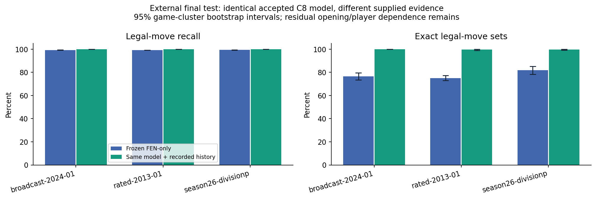

# Independent external generalization

The frozen accepted C8 model achieved **99.2645% legal-move recall**, **100.0000% precision**, and **793/1020 exact legal-move sets** on the final external test. It produced 0 false-legal, 0 false-illegal, 0 self-check false-legal, and 0 incomplete classifications. These are new finite-sample measurements. [analysis/frozen-summary.json](../../artifacts/cycle10/analysis/frozen-summary.json)

The model checkpoint, native runtime, native formulas and FEN-only inference policy were frozen at the starting commit. All registered operational positions were evaluated before any external adaptation or calibration refit. Secondary strict and experimental evaluations use the registered first ten final-test positions per collection. Their shard receipts retain every candidate, proof and budget outcome. [frozen-complete.json](../../artifacts/cycle10/frozen-complete.json); [evaluation shards](../../artifacts/cycle10/evaluation).

| Cohort | Population | Positions | Candidates | Exact | Precision | Recall | F1 | Coverage | Abstention rate | False legal | False illegal | Self-check false legal | Unknown | Incomplete |
|---|---|---|---|---|---|---|---|---|---|---|---|---|---|---|
| external-adaptation | complete | 144 | 24069 | 97 | 100.0000% | 98.9523% | 99.4734% | 98.2758% | 1.7242% | 0 | 0 | 0 | 415 | 0 |
| external-adaptation | in_board | 144 | 12689 | 97 | 100.0000% | 98.9523% | 99.4734% | 96.7295% | 3.2705% | 0 | 0 | 0 | 415 | 0 |
| external-adaptation/lichess-broadcast-2024-01 | complete | 48 | 8351 | 31 | 100.0000% | 98.8614% | 99.4274% | 98.2996% | 1.7004% | 0 | 0 | 0 | 142 | 0 |
| external-adaptation/lichess-broadcast-2024-01 | in_board | 48 | 4416 | 31 | 100.0000% | 98.8614% | 99.4274% | 96.7844% | 3.2156% | 0 | 0 | 0 | 142 | 0 |
| external-adaptation/lichess-rated-2013-01 | complete | 48 | 8410 | 30 | 100.0000% | 98.8686% | 99.4311% | 98.1926% | 1.8074% | 0 | 0 | 0 | 152 | 0 |
| external-adaptation/lichess-rated-2013-01 | in_board | 48 | 4481 | 30 | 100.0000% | 98.8686% | 99.4311% | 96.6079% | 3.3921% | 0 | 0 | 0 | 152 | 0 |
| external-adaptation/tcec-season26-divisionp | complete | 48 | 7308 | 36 | 100.0000% | 99.1441% | 99.5702% | 98.3443% | 1.6557% | 0 | 0 | 0 | 121 | 0 |
| external-adaptation/tcec-season26-divisionp | in_board | 48 | 3792 | 36 | 100.0000% | 99.1441% | 99.5702% | 96.8091% | 3.1909% | 0 | 0 | 0 | 121 | 0 |
| external-calibration | complete | 144 | 25754 | 93 | 100.0000% | 98.9553% | 99.4749% | 98.3071% | 1.6929% | 0 | 0 | 0 | 436 | 0 |
| external-calibration | in_board | 144 | 13213 | 93 | 100.0000% | 98.9553% | 99.4749% | 96.7002% | 3.2998% | 0 | 0 | 0 | 436 | 0 |
| external-calibration/lichess-broadcast-2024-01 | complete | 48 | 8914 | 31 | 100.0000% | 98.9467% | 99.4706% | 98.3173% | 1.6827% | 0 | 0 | 0 | 150 | 0 |
| external-calibration/lichess-broadcast-2024-01 | in_board | 48 | 4582 | 31 | 100.0000% | 98.9467% | 99.4706% | 96.7263% | 3.2737% | 0 | 0 | 0 | 150 | 0 |
| external-calibration/lichess-rated-2013-01 | complete | 48 | 8737 | 29 | 100.0000% | 98.8869% | 99.4404% | 98.2946% | 1.7054% | 0 | 0 | 0 | 149 | 0 |
| external-calibration/lichess-rated-2013-01 | in_board | 48 | 4475 | 29 | 100.0000% | 98.8869% | 99.4404% | 96.6704% | 3.3296% | 0 | 0 | 0 | 149 | 0 |
| external-calibration/tcec-season26-divisionp | complete | 48 | 8103 | 33 | 100.0000% | 99.0391% | 99.5172% | 98.3093% | 1.6907% | 0 | 0 | 0 | 137 | 0 |
| external-calibration/tcec-season26-divisionp | in_board | 48 | 4156 | 33 | 100.0000% | 99.0391% | 99.5172% | 96.7036% | 3.2964% | 0 | 0 | 0 | 137 | 0 |
| external-test | complete | 1020 | 172589 | 793 | 100.0000% | 99.2645% | 99.6309% | 98.4159% | 1.5841% | 0 | 0 | 0 | 2734 | 0 |
| external-test | in_board | 1020 | 90055 | 793 | 100.0000% | 99.2645% | 99.6309% | 96.9641% | 3.0359% | 0 | 0 | 0 | 2734 | 0 |
| external-test/lichess-broadcast-2024-01 | complete | 340 | 59777 | 260 | 100.0000% | 99.2273% | 99.6122% | 98.2886% | 1.7114% | 0 | 0 | 0 | 1023 | 0 |
| external-test/lichess-broadcast-2024-01 | in_board | 340 | 31060 | 260 | 100.0000% | 99.2273% | 99.6122% | 96.7064% | 3.2936% | 0 | 0 | 0 | 1023 | 0 |
| external-test/lichess-rated-2013-01 | complete | 340 | 58617 | 255 | 100.0000% | 99.1553% | 99.5758% | 98.3605% | 1.6395% | 0 | 0 | 0 | 961 | 0 |
| external-test/lichess-rated-2013-01 | in_board | 340 | 30550 | 255 | 100.0000% | 99.1553% | 99.5758% | 96.8543% | 3.1457% | 0 | 0 | 0 | 961 | 0 |
| external-test/tcec-season26-divisionp | complete | 340 | 54195 | 278 | 100.0000% | 99.4158% | 99.7070% | 98.6161% | 1.3839% | 0 | 0 | 0 | 750 | 0 |
| external-test/tcec-season26-divisionp | in_board | 340 | 28445 | 278 | 100.0000% | 99.4158% | 99.7070% | 97.3633% | 2.6367% | 0 | 0 | 0 | 750 | 0 |
| synthetic-adversarial | complete | 112 | 4976 | 98 | 100.0000% | 99.2227% | 99.6098% | 98.3320% | 1.6680% | 0 | 0 | 0 | 83 | 0 |
| synthetic-adversarial | in_board | 112 | 2816 | 98 | 100.0000% | 99.2227% | 99.6098% | 97.0526% | 2.9474% | 0 | 0 | 0 | 83 | 0 |
| synthetic-adversarial/synthetic-controlled-edit | complete | 112 | 4976 | 98 | 100.0000% | 99.2227% | 99.6098% | 98.3320% | 1.6680% | 0 | 0 | 0 | 83 | 0 |
| synthetic-adversarial/synthetic-controlled-edit | in_board | 112 | 2816 | 98 | 100.0000% | 99.2227% | 99.6098% | 97.0526% | 2.9474% | 0 | 0 | 0 | 83 | 0 |

The matched 30-position secondary panel contains 3 source games. Its strict, experimental and operational measurements are separately reported; it is not a second representative source sample. [analysis/secondary-modes.json](../../artifacts/cycle10/analysis/secondary-modes.json)

Complete populations include the seeded off-board negative candidates. In-board populations remove that easy negative stratum; exact position sets are evaluated against the same full legal reference set. Unknown candidates are retained in the denominators and are not silently counted as correct negatives. [analysis/frozen-summary.json](../../artifacts/cycle10/analysis/frozen-summary.json)

Game-cluster percentile bootstrap intervals are reported separately for every source and split (400 draws). Players, openings and engine opponents can remain correlated across games. Zero-error intervals do not establish universal zero risk. [metrics and intervals](../../artifacts/cycle10/analysis/frozen-summary.json)

Performance is stratified by phase, material count, opening family, tactical density, legal-move count, attacked pieces, multiple attackers and history completeness. These are descriptive associations, not independent causal effects. All 1,020 final-test positions have a published prefix available in the corpus, so that history-availability factor has one stratum. The frozen arm deliberately supplies only FEN; the separate temporal arm measures the effect of supplying the recorded prefixes. Per-piece and special-move candidate results are also retained. [analysis/frozen-factors.json](../../artifacts/cycle10/analysis/frozen-factors.json); [analysis/frozen-summary.json](../../artifacts/cycle10/analysis/frozen-summary.json)

Supplying actual published game prefixes to the same frozen model yields 99.9939% recall and 1018/1020 exact sets, with 0 false-legal and 0 false-illegal outcomes. This changes available evidence, not the learned checkpoint or threshold. [analysis/temporal-summary.json](../../artifacts/cycle10/analysis/temporal-summary.json)

The source population, license receipts, sampling restrictions and audits are described in [dataset provenance](dataset-provenance.md). No result establishes correctness outside the measured game, structural and historical distributions.
