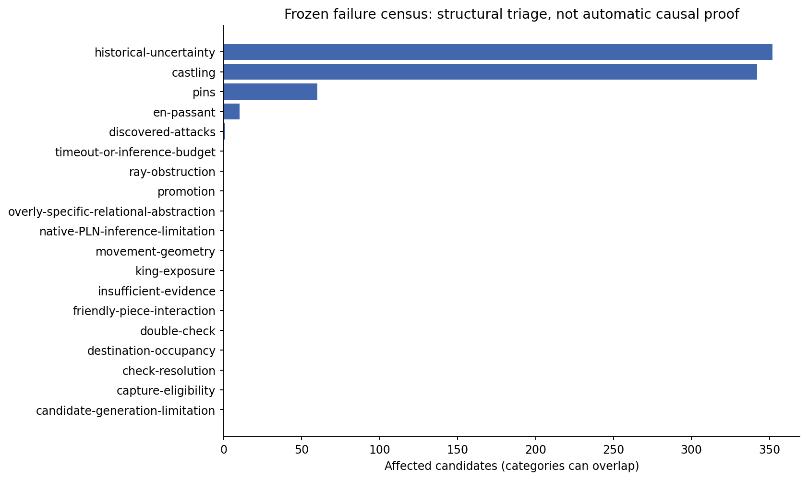

# Complete structural failure census

Every one of the **339 non-exact frozen positions** is accounted for. The index contains **352 unresolved or erroneous candidates** across all registered frozen operational cohorts. No final-test position was removed after inference. [analysis/frozen-verification.json](../../artifacts/cycle10/analysis/frozen-verification.json); [analysis/frozen-failure-index.json](../../artifacts/cycle10/analysis/frozen-failure-index.json)

| Taxonomy category | Positions | Candidates | Errors | Abstentions | Representative proof indices |
|---|---|---|---|---|---|
| candidate-generation-limitation | 0 | 0 | 0 | 0 | none observed |
| capture-eligibility | 0 | 0 | 0 | 0 | none observed |
| castling | 329 | 342 | 0 | 342 | 0, 1, 2, 3, 4 |
| check-resolution | 0 | 0 | 0 | 0 | none observed |
| destination-occupancy | 0 | 0 | 0 | 0 | none observed |
| discovered-attacks | 1 | 1 | 0 | 1 | 229 |
| double-check | 0 | 0 | 0 | 0 | none observed |
| en-passant | 10 | 10 | 0 | 10 | 64, 246, 312, 338, 339 |
| friendly-piece-interaction | 0 | 0 | 0 | 0 | none observed |
| historical-uncertainty | 339 | 352 | 0 | 352 | 0, 1, 2, 3, 4 |
| insufficient-evidence | 0 | 0 | 0 | 0 | none observed |
| king-exposure | 0 | 0 | 0 | 0 | none observed |
| movement-geometry | 0 | 0 | 0 | 0 | none observed |
| native-PLN-inference-limitation | 0 | 0 | 0 | 0 | none observed |
| overly-specific-relational-abstraction | 0 | 0 | 0 | 0 | none observed |
| pins | 56 | 60 | 0 | 60 | 19, 22, 63, 66, 67 |
| promotion | 0 | 0 | 0 | 0 | none observed |
| ray-obstruction | 0 | 0 | 0 | 0 | none observed |
| timeout-or-inference-budget | 0 | 0 | 0 | 0 | none observed |

Categories can overlap. Pins, discovered attacks, double check and check-resolution labels describe the position context; membership alone does not establish the cause of the failed candidate. An absent learned local descriptor, unsupported history and an unavailable complete positive native composition are different limitations. Taxonomy assignments are structural triage, with causal claims restricted to the temporal evidence interventions. [complete native traces and assessments](../../artifacts/cycle10/analysis/frozen-failure-proofs.json.xz)

Each indexed proof record includes the original fixture and source game, candidate, native truth values, classification, local conditional values, hypothesis IDs, evidence IDs, dependence groups and the reconstructed native proof graph. The inspector loads records by bounded index and can reopen the candidate. [analysis/frozen-failure-proofs.json.xz](../../artifacts/cycle10/analysis/frozen-failure-proofs.json.xz)

Candidate-generator omissions are audited before inference against the offline reference library. Budget failures remain separate from missing knowledge and enter the failure census rather than being retried with a different decision criterion. [datasets/manifest.json](../../artifacts/cycle10/datasets/manifest.json); [analysis/frozen-failure-index.json](../../artifacts/cycle10/analysis/frozen-failure-index.json)

The same complete census is delivered for both experimental adaptations and the actual-history evaluation. Legacy root-cause labels can retain a history term even when a published prefix was supplied; the actual-history residual assessment separately exposes that distinction and the native local conditional premises. [analysis/small-failure-index.json](../../artifacts/cycle10/analysis/small-failure-index.json); [analysis/large-failure-index.json](../../artifacts/cycle10/analysis/large-failure-index.json); [analysis/temporal-failure-index.json](../../artifacts/cycle10/analysis/temporal-failure-index.json); [temporal/actual-history-residuals.json](../../artifacts/cycle10/temporal/actual-history-residuals.json)
