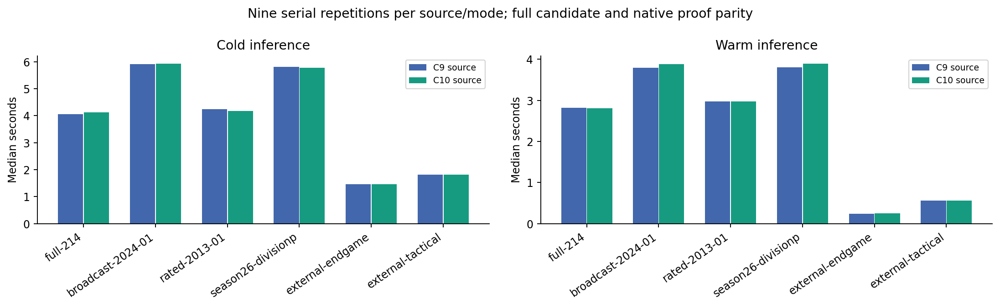

# Inference performance, memory and proof parity

The original Cycle 9 source and the final Cycle 10 source were each benchmarked serially on six identical workloads, with nine reference/cold/warm repetitions per workload: **324 new comparison samples**. The separate historical baseline replay adds 126 samples. No other study native workers run during timed benchmark arms. [performance/comparison.json](../../artifacts/cycle10/performance/comparison.json); [baseline/performance/C9-reproduced.json](../../artifacts/cycle10/baseline/performance/C9-reproduced.json)

Cold means a new inference session/cache with the checkpoint already loaded; warm immediately reuses that session. Reference disables the optimized path. These are not fresh-process or cold-filesystem timings. Checkpoint loading is recorded separately as one measurement per source block.

| Workload | Mode | C9 p50 s | C10 p50 s | C10 p95 s | C10 p99 s | Median ratio | 95% ratio interval |
|---|---|---|---|---|---|---|---|
| full-214 | cold | 4.0461805 | 4.1176538 | 4.3150505 | 4.3150505 | 1.0176644 | [0.9806220552115736, 1.0358092533703176] |
| full-214 | reference | 25.802107 | 25.861519 | 26.021701 | 26.021701 | 1.0023026 | [0.9945506228345256, 1.011101859618159] |
| full-214 | warm | 2.8190405 | 2.8105344 | 2.9956908 | 2.9956908 | 0.99698263 | [0.9536976485977572, 1.0528682079791492] |
| dense-lichess-broadcast-2024-01 | cold | 5.9003899 | 5.9234569 | 5.9798637 | 5.9798637 | 1.0039094 | [0.9886509801580772, 1.014990133367331] |
| dense-lichess-broadcast-2024-01 | reference | 30.740585 | 30.855785 | 31.050882 | 31.050882 | 1.0037475 | [0.9985714205281013, 1.0095784605005063] |
| dense-lichess-broadcast-2024-01 | warm | 3.7963707 | 3.8878278 | 3.9237684 | 3.9237684 | 1.0240907 | [0.9690953247945353, 1.032776845240354] |
| dense-lichess-rated-2013-01 | cold | 4.2350766 | 4.1718072 | 4.33847 | 4.33847 | 0.98506063 | [0.963277394848983, 1.0433427376350253] |
| dense-lichess-rated-2013-01 | reference | 26.681151 | 26.719802 | 26.757598 | 26.757598 | 1.0014486 | [0.9967028879931827, 1.0091178066671935] |
| dense-lichess-rated-2013-01 | warm | 2.9700404 | 2.9744377 | 3.1784723 | 3.1784723 | 1.0014806 | [0.9562452756934561, 1.047654625700942] |
| dense-tcec-season26-divisionp | cold | 5.8116718 | 5.7760754 | 5.93365 | 5.93365 | 0.99387501 | [0.9786273713777293, 1.0133963762363025] |
| dense-tcec-season26-divisionp | reference | 30.262541 | 30.363393 | 30.643147 | 30.643147 | 1.0033326 | [0.9943103820215463, 1.007243381857841] |
| dense-tcec-season26-divisionp | warm | 3.8063796 | 3.8932501 | 3.9788473 | 3.9788473 | 1.0228223 | [0.9743028327801093, 1.0469600844065534] |
| external-endgame | cold | 1.4526072 | 1.4617696 | 1.5218752 | 1.5218752 | 1.0063075 | [0.9836812060235637, 1.0340448284002854] |
| external-endgame | reference | 1.586033 | 1.5834314 | 1.6498335 | 1.6498335 | 0.99835971 | [0.9683967447521501, 1.0191269670431296] |
| external-endgame | warm | 0.24426766 | 0.25340366 | 0.27430703 | 0.27430703 | 1.0374016 | [0.976508691395037, 1.0580208879431738] |
| external-tactical | cold | 1.8144895 | 1.8160998 | 1.8839967 | 1.8839967 | 1.0008874 | [0.974512845392193, 1.018163973037802] |
| external-tactical | reference | 3.9073127 | 3.9166843 | 3.9999931 | 3.9999931 | 1.0023985 | [0.9859590924907402, 1.0233299834962617] |
| external-tactical | warm | 0.5627087 | 0.56132969 | 0.60336657 | 0.60336657 | 0.99754934 | [0.9842917569214762, 1.0465865690365455] |

Every reference, cold and warm run preserves the full candidate payload and native proof graph; all warm samples require zero native invocations. Measured timeout and truncation rates, grounded atoms, invocation counts, cache hits, checkpoint loading, checkpoint size, parent RSS and terminated-child RSS are retained per sample. Parent and child high-water marks are separate cumulative quantities, not a simultaneous combined memory peak. [performance/C9-external.json](../../artifacts/cycle10/performance/C9-external.json); [performance/C10-current.json](../../artifacts/cycle10/performance/C10-current.json)

Nine repetitions support descriptive median comparisons; p95/p99 are observed maxima and cannot establish reliable population tails. Ratio intervals use 2,000 bootstrap resamples within each serial source block. Host drift and block order remain potential confounders. A nonsignificant difference does not prove equal latency. [performance/comparison.json](../../artifacts/cycle10/performance/comparison.json)

Native formulas, candidate grammar, observation construction, proof scheduling and learned model maps remain unchanged for the accepted model. Existing Cycle 9 caching is retained. The recorded profiles cover the final external-tactical workload with a warm inference cache. They inspect candidate generation, cache keys, evidence lookup and proof reconstruction; cold observation work is represented by the invocation/atom/cache measurements rather than a separate component profile. No speculative optimization is introduced. [performance/C9-external-profile.txt](../../artifacts/cycle10/performance/C9-external-profile.txt); [performance/C10-current-profile.txt](../../artifacts/cycle10/performance/C10-current-profile.txt)

Temporal receipt construction and verification are timed independently on real full games, empty history and a 520-event structural sequence. Source, confidence and event mutations are checked against fresh native sessions; every candidate and proof must match. [performance/temporal.json](../../artifacts/cycle10/performance/temporal.json); [performance/temporal-cache-proofs.json.xz](../../artifacts/cycle10/performance/temporal-cache-proofs.json.xz)
