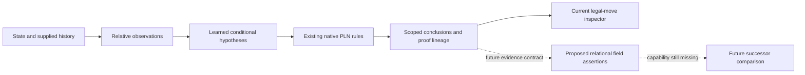

# Strategic readiness: relational fields without a playing engine

Cycle 10 prepares an ontology and test plan. It does not implement field scores, strategic move selection, search, handcoded piece-square tables or a chess evaluation function. The legal-move learner remains the operational system. Proposed relationships below are research interfaces, not executed native proofs.

The existing [relative ontology](../../src/pln_chess/cycle4/ontology.py), [promotion observations](../../src/pln_chess/cycle8/ontology.py), [native inference pipeline](../../src/pln_chess/cycle5/inference.py) and [proof-mode policy](../../src/pln_chess/cycle6/inference.py) already separate sensed geometry, learned conditional knowledge, native derivations and decision policy. Those distinctions should remain explicit in any future strategic representation.

| Field | Reusable relative observations | Proposed assertion | Evidence and inference still needed |
|---|---|---|---|
| Spatial interaction | Piece-oriented displacement, relative ray cells, destination ownership, boundary observations | `SpatialInteraction(piece-role, relative-target-role, context)` | Learn target-specific interactions across independent games and transformed controls. A host ray observation alone is not a probabilistic interaction theorem. |
| Attack and defense | Existing attacker/king frames, occupancy, obstruction and native attack conditionals | `Attacks(attacker-role, target-role, state)` and `Defends(defender-role, defended-role, state)` | Existing king-exposure attacks are scoped to that target. General-piece attack and defense need independent labels and held-out target types. Defense is not automatically the color-reversed legality of capturing a friendly piece. |
| Mobility | Candidate grammar, supported/contradicted/unknown/incomplete outcomes | `HasSupportedTransition(piece-role, successor-role)` and a set-valued mobility report | A count may be a descriptive statistic; turning it into strategic utility requires separately validated evidence. Unknown and incomplete candidates must remain visible. |
| King exposure | Structural successor, opponent frames, native attack-to-exposure and negative legality chains | `Exposed(king-role, attacker-role, successor)` | Negative chains are supported in the present system. Absence of a discovered threat is not a native universal safety proof. Do not infer safe from an empty attack list. |
| Strategic influence | Local interactions, obstruction, pins and discovered-attack contexts | `Influence(piece-role, region-role, objective, horizon)` | Region roles should be relational neighborhoods, not absolute board-square tables. Objectives, horizon, conditional population and independent supervision are presently unspecified. |
| Successor-state change | Existing structural state transitions, event lineage, before/after context | `RelationChange(relation-id, before-state, after-state, source)` | Exact changes in sensed relations can be reported. Comparing uncertain field values needs a defined joint model and dependence-preserving transport; subtracting unrelated marginal confidences is not an inference rule. |

An assertion should carry subject and target role IDs, state/frame identity, predicate version, relative descriptor, source evidence IDs, dependence groups, temporal scope, model/runtime identity, raw native truth value, proof category and incomplete status. A separate optional empirical diagnostic can name its calibration population and uncertainty interval. Coordinates can serialize input and output states, but must not become learned rule keys or strategic priors.

The following boundaries matter for a future implementation:

- **Reuse supported native behavior.** Revision, conditional elimination, negation and demonstrated negative chains can be reused with their existing scopes and dependence assumptions. A new predicate name does not grant a new operator or broaden a proved conclusion.
- **Keep partial and complete claims separate.** A supported local move or attack conditional does not establish all-premise conjunction, universal king safety, causal strategic advantage or winning probability. The [Cycle 9 composition decision](../cycle9/architecture-decision.md) remains binding.
- **Preserve temporal provenance.** A state change supplied by a game record, imported metadata, inferred historical relation and unknown history are different evidence types. Future fields must name which one they depend on and retain retraction paths when an event or source is removed.
- **Specify dependence before aggregating influence.** Two pieces may share a learned hypothesis, a source game, an opening family or a predecessor event. Adding their strengths or treating their confidence as independent would invent support. Evidence removal, shared-ancestor and contradictory-source controls are required.

The initial research experiments should use local relational prediction tasks rather than winning games. First, learn attack and defense assertions for non-king targets from a separate labelled corpus; hold out piece combinations and opening families, and retain matched geometry with changed occupancy. Second, test whether a supplied move changes only the relevant local assertions while shared proof ancestry is retained. Third, measure calibration drift for each predicate population separately. Finally, test retraction and partial-history cases. Strategic utility labels or search should require a new explicit experiment plan after these steps succeed.

Computationally, the current learner constructs candidate-specific successors and opponent frames. Repeating that work for every proposed field and every possible successor can multiply native scheduling, proof volume and cache state. A future prototype should first count frames, native invocations, duplicated evidence nodes and retained proof bytes; introduce bounded caches keyed by model, runtime, observation and history identity; and return incomplete rather than silently truncate. Cycle 10 latency measurements apply only to the present learner and replay interfaces, not to an unimplemented strategic system.

Readiness is therefore **partial**: reusable observations, source-bound models and inspectable proof records exist. Native composition of uncertain independent premises, general defense semantics, calibrated influence targets and strategic successor comparison remain research gaps. No claim of strategic intelligence follows from finite legality results.
