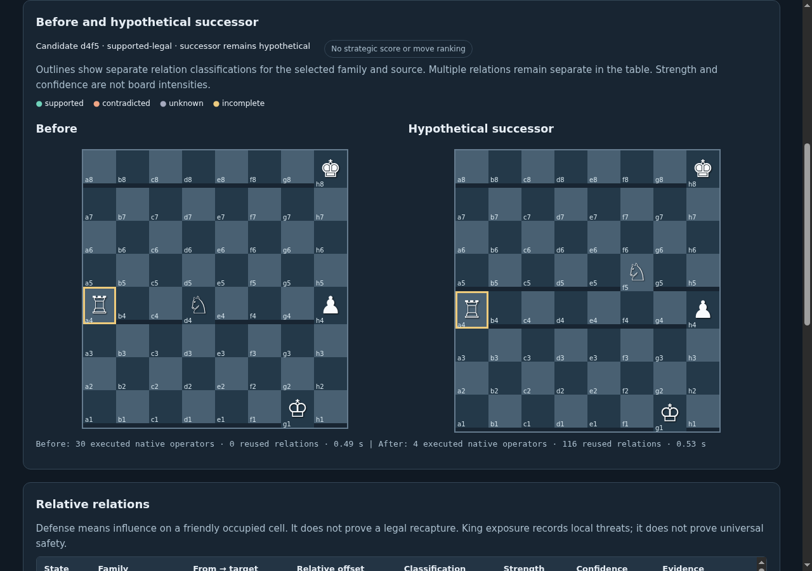

# Candidate fields and typed differences

15 worked examples preserve full initial/successor environments, selected candidate status, relative observations, field records, native proofs and offline reference checks. [fields/worked-examples.json.xz](../../artifacts/cycle11/fields/worked-examples.json.xz).

The compact [proof review index](../../artifacts/cycle11/fields/worked-proof-index.json) selects one declared relation per worked example for inspection, retaining both complete native traces and environment bindings. Its post-evaluation selection is for review only, not an accuracy estimate or model-selection step.

| Worked example | Candidate status | Before / after relations | Changed relations |
|---|---|---:|---:|
| rook-obstruction | supported-legal | 643 / 643 | 157 |
| bishop-diagonal | supported-legal | 514 / 514 | 154 |
| knight-relocation | supported-legal | 383 / 383 | 139 |
| pinned-defender | supported-illegal | 643 / 643 | 152 |
| discovered-attack | supported-legal | 514 / 514 | 158 |
| king-exposure | supported-illegal | 512 / 512 | 146 |
| multiple-defenders | supported-legal | 647 / 647 | 155 |
| unknown-observation | unknown | 520 / 520 | 145 |
| promotion | supported-legal | 383 / 383 | 139 |
| en-passant | unknown | 643 / 514 | 284 |
| rook-battery | supported-legal | 514 / 514 | 153 |
| defended-minor | supported-legal | 514 / 514 | 153 |
| double-check-resolution | supported-legal | 514 / 514 | 144 |
| discovered-defense | supported-legal | 647 / 647 | 158 |
| en-passant-exposure | supported-illegal | 643 / 512 | 284 |

The structural successor applies movement, destination capture, promotion, castling rook relocation and off-destination en-passant removal without deciding legality. Candidate legality comes from the separate accepted C8 learner. A hypothetical successor is not an observed state or verified legal continuation.

The comparison is a typed collection. Each changed relation retains its before/after truth values, conditional rule IDs, evidence IDs, dependency footprints and proof identities. Missing relations are not zero-valued negative beliefs. Unknown-to-supported transitions remain distinguishable from contradicted-to-supported transitions. Opened/obstructed rays are structural observations.

All change propositions are labeled `host-diagnostic` and carry `change_truth_value: null`. Native proofs establish the separately scoped before/after conditionals, not a native probabilistic theorem for their difference. No strengths are added or multiplied, and no aggregate strategic score or move ranking is produced.

The inspector exposes piece/family/candidate selection, before/after board projections, relative relation rows, proof inspection and export. The board is a display coordinate system only. [Desktop/mobile browser evidence](../../artifacts/cycle11/ui/verification.json).

[Recorded browser workflow, video and screenshots](../../artifacts/cycle11/ui/2026-11-10_11-45-44_cycle-11-field-selection-hypothetical-su/SUMMARY.md); [mobile comparison](../../artifacts/cycle11/ui/2026-11-10_11-45-44_cycle-11-field-selection-hypothetical-su/mobile-before-after.png).

