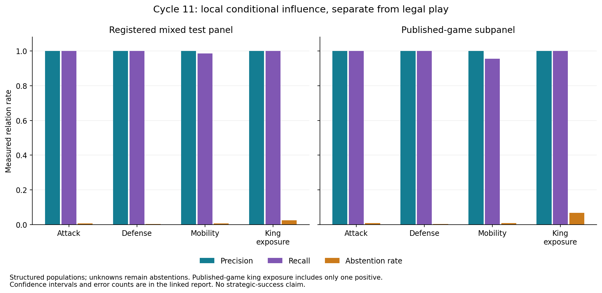
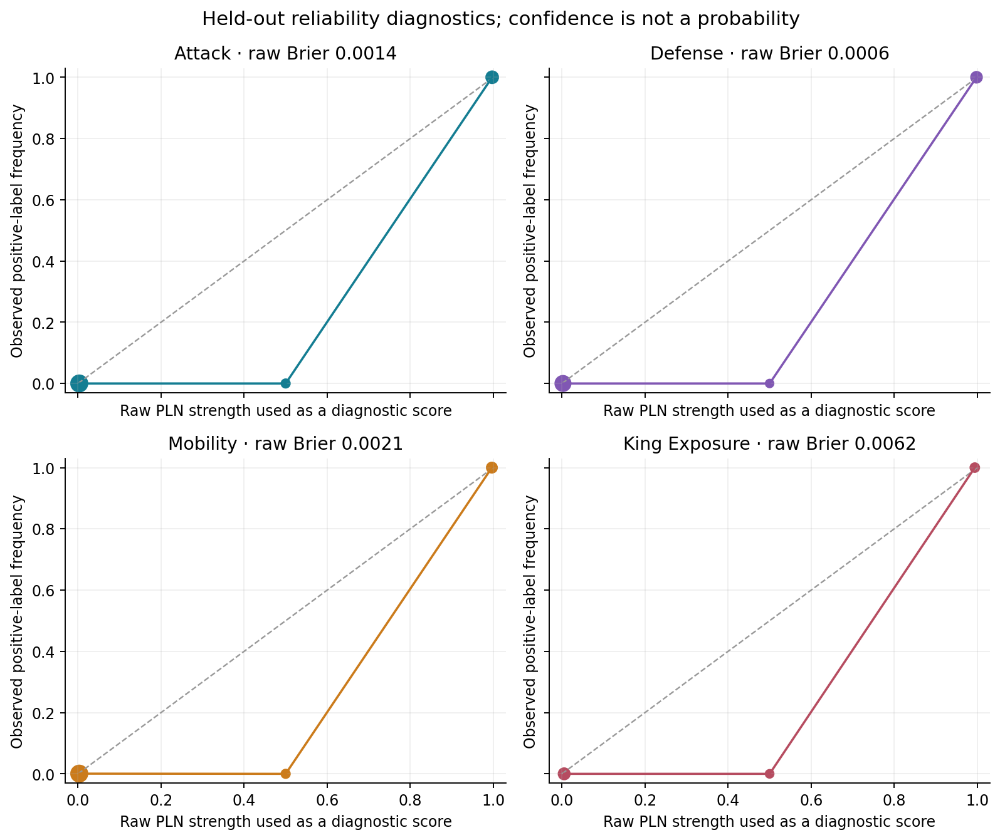

# Relational field evaluation

The evaluator joins offline reference labels only after production inference returns. Geometry, attack, defense, ordinary mobility and per-source king exposure have distinct labels and domains. Full native proof graphs and their hashes accompany each shard. No legal-move accuracy is substituted for field accuracy.

| Field | Relations | Precision | Recall | Abstention | False support / contradiction | Native conditional proofs |
|---|---:|---:|---:|---:|---:|---:|
| attack | 15557 | 100.000% | 100.000% | 0.553% | 0 / 0 | 15471 |
| defense | 8354 | 100.000% | 100.000% | 0.239% | 0 / 0 | 8334 |
| mobility | 15464 | 100.000% | 98.580% | 0.608% | 0 / 9 | 15370 |
| king-exposure | 1431 | 100.000% | 100.000% | 2.446% | 0 / 0 | 1396 |

Published-game subpanel:

| Field | Relations | Precision | Recall | Abstention | False support / contradiction | Native conditional proofs |
|---|---:|---:|---:|---:|---:|---:|
| attack | 9850 | 100.000% | 100.000% | 0.873% | 0 / 0 | 9764 |
| defense | 5994 | 100.000% | 100.000% | 0.334% | 0 / 0 | 5974 |
| mobility | 9825 | 100.000% | 95.631% | 0.885% | 0 / 9 | 9738 |
| king-exposure | 519 | 100.000% | 100.000% | 6.744% | 0 / 0 | 484 |

38/38 registered transformation/counterfactual controls passed. Failures, if any: `[]`. Controls cover translation, valid reflection, color-relative orientation, piece-ID renaming, irrelevant distant edits, inserted blockers and unknown ray cells. They test sensitivity as well as invariance. [fields/transformations.json.xz](../../artifacts/cycle11/fields/transformations.json.xz).

Calibration uses only the separate calibration partition to fit ten-bin Laplace diagnostic mappings. Raw and mapped Brier/log-loss/ECE, reliability bins and covered-only scores are retained. Thresholds and native classifications remain unchanged. Confidence is not plotted as a probability. [field-evaluation/calibration.json](../../artifacts/cycle11/field-evaluation/calibration.json).

Vector exports: [relation results](../../artifacts/cycle11/figures/relation-results.svg), [reliability diagnostics](../../artifacts/cycle11/figures/relation-reliability.svg).

The frozen primary mobility results include 9 false negatives, of which 9 are reference king-to-rook castling aliases missed by the label adapter's two-cell castle exclusion. The post-freeze audit documents this domain mismatch without changing original labels, denominators, models or thresholds. A future independently registered ordinary-mobility panel should exclude every castling encoding before sampling. [field-evaluation/post-freeze-false-negatives.json](../../artifacts/cycle11/field-evaluation/post-freeze-false-negatives.json). The external king-exposure subpanel has only one positive, so its positive recall is particularly weak evidence.

The panel is a deliberately structured mixture, not a representative sample of chess positions. Some controlled contexts are invalid as complete game states; their local relation labels remain defined, and reference-valid-only metrics are reported separately. Group bootstrap resamples connected source/generator/declared-ancestry components, including shared openings, not individual related queries. Two controlled holdout generator groups provide weak interval resolution. Native conditional coverage and unsupported global composition are reported separately. [field-evaluation/summary.json](../../artifacts/cycle11/field-evaluation/summary.json).
