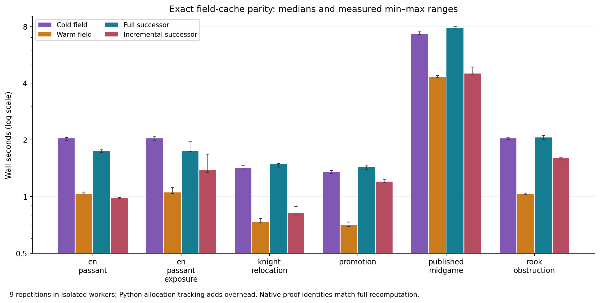

# Field performance and exact reuse

Each workload ran in a fresh worker for 9 repetitions, after other native study workers finished. Full and incremental outputs have identical relation values and native proof IDs. Pure native-expression caching and exact local-relation reuse are separately counted. [performance/summary.json](../../artifacts/cycle11/performance/summary.json).

[Recorded host and runtime environment](../../artifacts/cycle11/performance/environment.json). Native study workers were quiescent before measurements; this does not imply exclusive use of the machine by the operating system or unrelated services.

Cold means a fresh field/native-expression session; operating-system file caches are not flushed. Warm means an identical request using the same field session. Neither label includes interpreter or model-loading startup.

| Workload | Cold field median s | Warm median s | Full successor median s | Incremental median s | Reused / invalidated relations |
|---|---:|---:|---:|---:|---:|
| en-passant | 2.0385 | 1.0373 | 1.7362 | 0.9797 | 361 / 151 |
| en-passant-exposure | 2.0344 | 1.0502 | 1.7476 | 1.3880 | 361 / 149 |
| knight-relocation | 1.4213 | 0.7350 | 1.4844 | 0.8174 | 246 / 135 |
| promotion | 1.3505 | 0.7063 | 1.4394 | 1.1991 | 246 / 135 |
| published-midgame | 7.3136 | 4.3182 | 7.8291 | 4.4959 | 2610 / 255 |
| rook-obstruction | 2.0342 | 1.0338 | 2.0557 | 1.5969 | 488 / 153 |

| Workload | Native invocations full / incremental | Grounded atoms full / incremental | Incremental proof bytes | Maximum incremental Python allocation bytes |
|---|---:|---:|---:|---:|
| en-passant | 72 / 0 | 2978 / 2978 | 4647254 | 7,002,897 |
| en-passant-exposure | 74 / 2 | 2976 / 2976 | 4666800 | 6,971,097 |
| knight-relocation | 66 / 0 | 2224 / 2224 | 3342838 | 6,331,383 |
| promotion | 66 / 2 | 2168 / 2168 | 2993784 | 6,331,383 |
| published-midgame | 80 / 0 | 17624 / 17624 | 29948433 | 36,040,117 |
| rook-obstruction | 74 / 2 | 3796 / 3796 | 5986505 | 8,721,603 |

[Vector performance figure](../../artifacts/cycle11/figures/field-performance.svg).

The cache binds model identity, runtime manifest, inference options, observation source and complete relevant dependencies. Long rays include every participating cell; there is no fixed neighborhood radius. Source motion, promotion, target identity, capture, off-destination EP removal, unknown-cell edits and castling rook motion invalidate affected relations. An unrelated distant edit may preserve a local proof while the enclosing state certificate changes.

The current implementation recomputes observation fingerprints for the requested relations and returns complete proof records even on a warm request. Reuse saves native calculation and proof construction; it does not eliminate observation scanning, copying or serialization. Speedup is therefore measured separately from cache-hit counts and is not guaranteed for every workload.

The raw measurements include single-candidate full/incremental updates, three successive alternatives sharing a parent cache, native operator counts, grounded atoms, proof bytes, hits/invalidations and Python allocation peaks. Maximum fresh-worker RSS: 445,836 KiB. Maximum child-process high-water RSS: 441,624 KiB. These are not summed concurrent memory. [performance/measurements.json.xz](../../artifacts/cycle11/performance/measurements.json.xz).

Model/runtime initialization, the structural successor edit and separate candidate legality inference are excluded from per-condition field timing. Observation, grounding, native execution, proof assembly and proof-size accounting are included. The multiple-candidate conditions measure field construction for three structural alternatives; they do not time move search or selection. `tracemalloc` adds overhead. Nine repetitions give weak p95 resolution; minima/maxima and all individual samples are retained. Cache reuse is an exact engineering optimization, not a probabilistic inference or strategic search result.
