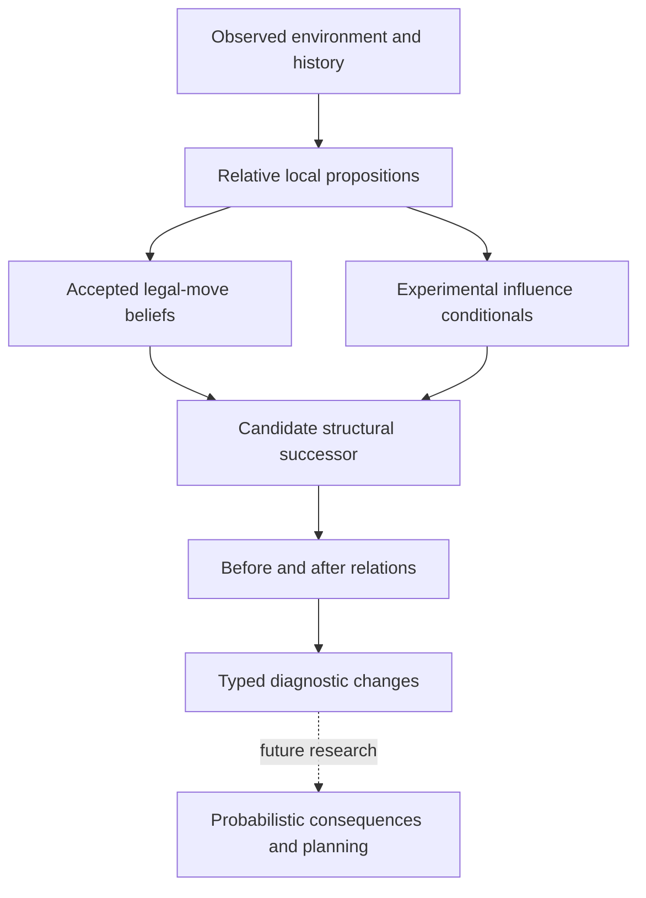

# Strategic architecture roadmap

Cycle 11 supplies an experimental descriptive layer: typed relative influence beliefs, structural hypothetical successors, native conditional proofs and provenance-preserving comparisons. It supplies no strategic move selector or optimality claim.

Verified native revision, unary conditional modus ponens, negation and evidence selection support the existing layer. Existing negative exposure chains support specific candidate illegality evidence. They do not establish a joint probabilistic model of interacting fields, universal safety, a native change proposition, or long-horizon utility.

| Future requirement | Present support | Research needed |
|---|---|---|
| Learned strategic concepts | Typed local relations and evidence ledger | Define and independently label consequences such as recoverable material, coordination and durable threats; avoid handcoded weighted sums |
| Field interactions | Separate relations and dependence metadata | Semantics for shared-cause evidence and uncertain-premise composition; independent native audit and explicit authorization before new operators |
| Field propagation | Exact dependency graph and structural edits | Valid causal transitions and temporal decay/update semantics; no informal diffusion of strengths |
| Temporal planning | Supplied-event replay and hypothetical successors | Branch-specific provenance, observation/action distinctions, delayed consequences and uncertainty-preserving search |
| Move comparison | Candidate legality and typed changes | Learn preference/utility targets separately; retain incomparable or unknown outcomes |
| Experience-based learning | Native revision and ancestry-aware ingestion | Prospective data acquisition, policy-induced selection bias and clean held-out strategic outcomes |
| Long-term memory | Immutable evidence/model/receipt identities | Retrieval by relative structure, contradiction/retraction, distribution shifts and bounded memory |
| Native composition | Audited conditional and negative chains | Joint premise semantics, proof certificates and calibration before any positive-composition extension |

Cycle 12 should first test independently acquired relation panels, broaden observed occupancy/temporal coverage, and investigate residual local abstentions without weakening gates. It should then define small, falsifiable consequence targets with prospective splits. A composition proposal must explain dependencies and native semantics before implementation. Strategic strength needs separate outcome-based evaluation; attack-map accuracy cannot establish it.
