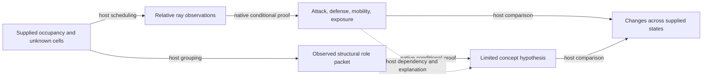

# Dependency graph and scheduling

The graph makes the reasons for recomputation inspectable. It is also an index
over native proof records; its topology cannot perform probabilistic inference.

Solid arrows labelled “native conditional proof” refer to existing executed
native TV nodes. Their premises, rule identifiers, evidence and dependence
groups remain inspectable. Other arrows describe scheduling, observation
grouping or comparison and carry no truth value. In particular, the dashed
field-to-concept edge does not assert that several uncertain field conclusions
have been conjoined by PLN.

The occupancy index maps concrete cells to the relative observations that read
them. A changed source, destination or intervening cell invalidates affected
relations. Promotion also changes the mover's kind. Castling changes both moved
entities. En passant changes the mover, destination and captured-pawn cell;
changes to the en-passant metadata invalidate ordinary mobility applicability
even when the board occupancy is identical.

Each relation node retains the model, runtime, matched conditional, source
observation, native proof ID, evidence IDs and dependence groups. Concept nodes
retain both their packet conditional and the independent component-field
records. Shared ancestry remains shared in the graph; repeated temporal
observations are not counted as independent learning updates.

For incremental evaluation, unchanged local records can be reused only within a
matching model, runtime, option and provenance scope. Query and full-state
bindings are attached anew. Returned data is copied so inspector-side mutation
cannot poison the cache. New and removed domain members are handled explicitly.
Logical proof limits apply to cached results as well as executed native work.

Correctness is measured against full recomputation, comparing every returned
relation, truth value, proof node, evidence reference, directional index and
board projection. Graph parity is checked separately. Performance reports
distinguish host work avoided, native operations executed, pure native-math
cache reuse, proof volume and memory. No speed claim is accepted without exact
semantic and proof parity for the measured workload.
