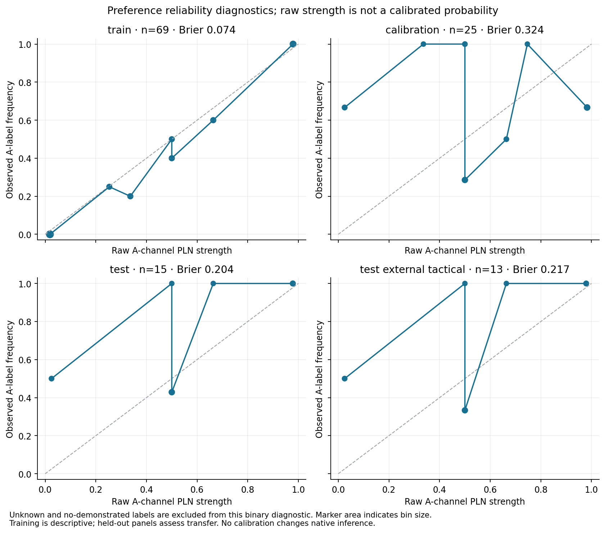
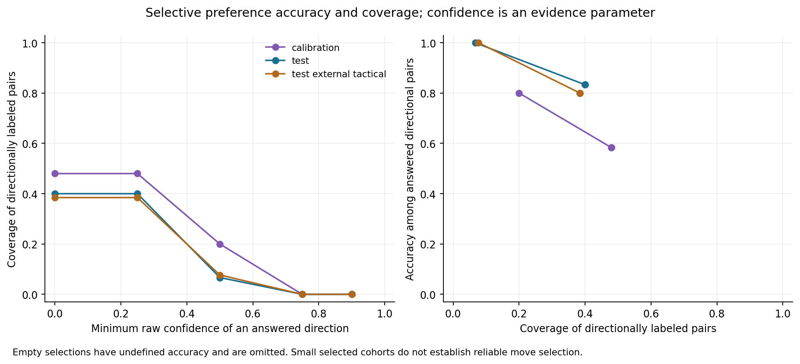
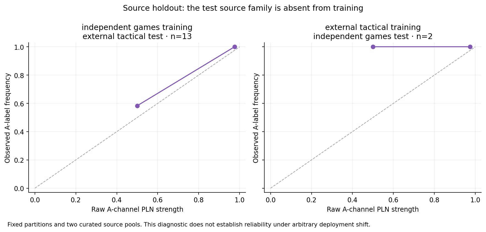

# Measured calibration diagnostics

Raw PLN strength and confidence remain separate from empirical correctness. The diagnostics compare the A-channel strength with resolved A/B labels; the three channels are not normalized probabilities. Confidence is used only as a reported evidence/selection parameter. No calibrator was fitted and no diagnostic changes production inference.

| Panel | Resolved A/B labels | Brier score | ECE |
| --- | --- | --- | --- |
| calibration | 25 | 0.324 | 0.341 |
| test | 15 | 0.204 | 0.158 |
| test-ambiguous | 0 | undefined | undefined |
| test-external-tactical | 13 | 0.217 | 0.219 |
| test-independent-games | 2 | 0.125 | 0.262 |
| test-promotion | 1 | 0.001 | 0.025 |
| test-quiet | 4 | 0.125 | 0.012 |
| test-unknown-reference | 0 | undefined | undefined |
| train | 69 | 0.074 | 0.035 |

| Training pairs | Test accuracy | Directional coverage | Brier |
| --- | --- | --- | --- |
| 25 | 1.000 | 0.133 | 0.217 |
| 50 | 0.667 | 0.200 | 0.263 |
| 100 | 0.750 | 0.267 | 0.247 |
| 222 | 0.833 | 0.400 | 0.204 |

The source-holdout fits train on games only or tactics only, then evaluate the unchanged test partition from both pools. This is stronger than merely stratifying a mixed-source test set, but it still covers only two curated source pools. Small answered subsets and conservative unknown teacher labels limit every reliability claim. No confidence threshold is selected on the test set.

Evidence: [preferences/calibration.json](../../artifacts/cycle13/preferences/calibration.json), [preferences/evidence-volume.json](../../artifacts/cycle13/preferences/evidence-volume.json), [preferences/distribution-shift.json](../../artifacts/cycle13/preferences/distribution-shift.json), [figures/manifest.json](../../artifacts/cycle13/figures/manifest.json).
