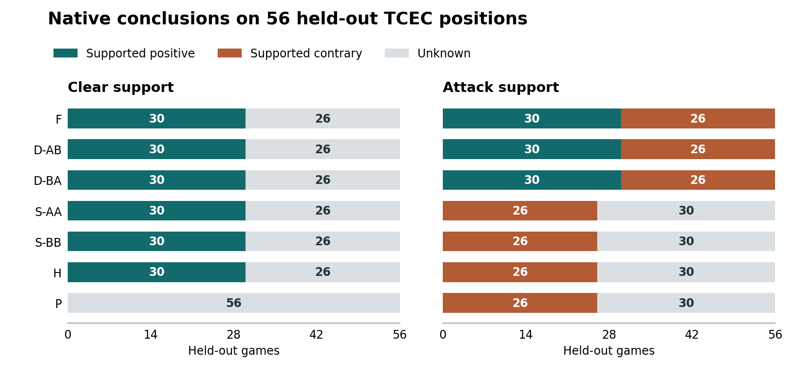

# Corpus and transfer scope

The registered census examined all 224 available games of the licensed TCEC Season 26 Premier Division archive under the registered ceiling of 240. It excluded 96 source-game identities used in Cycles 16–17; Cycle 18 reused that material, and Cycle 15 supplied synthetic roots. It found 128 eligible new consequence-study games. Selection was frozen in registration commit `f274493e`, before new target measurements or learned predictions. The frozen-source replay reproduces the manifest exactly with the influence oracle disabled.

There are 48 training roots (24 A and 24 B), 24 development roots, and 56 test roots, each from a distinct game. The test target of 72 was missed by 16; the bounded search and structural selection rule were retained. Training requires the raw empty-path antecedent. Natural evaluation requires only the registered rook/endpoint/two-cell geometry, never a favorable evaluator or native result. The upstream source is an existing project archive, so these games are new to the Cycle 15–18 consequence learner, not globally new to the project.

| Split | Games/roots | EE | EO | OE | OO | Directions |
|---|---:|---:|---:|---:|---:|---|
| A | 24 | 24 | 0 | 0 | 0 | +x 9, +y 7, -x 8 |
| B | 24 | 24 | 0 | 0 | 0 | +x 8, +y 7, -x 9 |
| Development | 24 | 7 | 10 | 4 | 3 | +x 8, +y 8, -x 8 |
| Test | 56 | 30 | 11 | 15 | 0 | -y 55, +x 1 |

The first 12 test roots receive the complete nine-case E/O/U matrix: 48 known-occupancy interventions and 60 variants with deliberately withheld observations. They also receive 36 dependent representation controls: renaming, rotation, and reflection. These are 144 variants of 12 existing games, not additional independent sources. Together with 128 natural episodes, the study measures 272 episodes and evaluates the registered subset of arms per population. Historical native anchors and hand-declared fixtures remain separate populations.

All 56 test games and surrounding relational contexts are absent from training. Fifty-five test endpoint pairs and directions are absent from training; one test pair uses the registered fallback. Development has one new endpoint pair and 23 new surrounding contexts. The canonical local-geometry audit includes the relative offset, so its 55 novel test values reflect the direction holdout. Every task still uses exactly two intervening cells: there is no unseen path-length result. The source collection is shared everywhere.

The natural selection and novelty audit are in `artifacts/cycle19/corpus-registration.json` and `measurement/novelty.json`. Absolute coordinates occur in source and audit records, never in learned rule conditions. The native adapter assigns local cell roles and passes relative geometry. Surrounding-board novelty is an audit property: inference receives the registered structural neighborhood, so this does not demonstrate whole-board context learning. Representation transformations test invariance under the supplied templates; they do not establish discovered structural knowledge.

The source acquisition hash is `7e86f395e832fc876fddf76989ce866a464839410ed37becdaa28ab39f69f1d7`. Derived position records retain CC-BY-SA-3.0 attribution to the Top Chess Engine Championship organization. The pinned acquisition receipt, publisher terms, and license are copied under `artifacts/cycle19/source-license/`. Shared openings, engines, publisher and upstream software limit population independence even when game IDs differ. Descriptive intervals state that limitation explicitly.

Joining the complete game move sequences to the Cycle 10 legal dataset identifies 29 shared games among the 128 and 8 roots at the same game and ply. The join, splits and fixture IDs are recorded in [the upstream overlap audit](../../artifacts/cycle19/earlier-game-overlap.json).

The test panel below gives every one of the 56 games equal weight. Counts inside each bar distinguish supported conclusions from bounded unknown results. Clear has no explicit contrary rule in this encoding. Attack has a supplied obstruction rule.

On the 55 downward rays, D-AB supported Attack in 29 positions and NoAttack in 26. The single fallback root accounted for the remaining positive test result. The 55 unseen ordered endpoint pairs had the same 29 / 26 split. These overlapping subgroups answer different novelty questions about the same test panel. [Test transfer counts](../../artifacts/cycle19/test-transfer.json)
