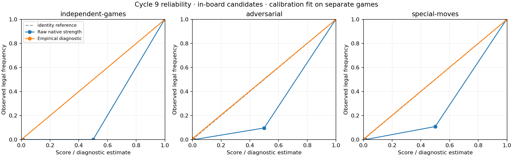
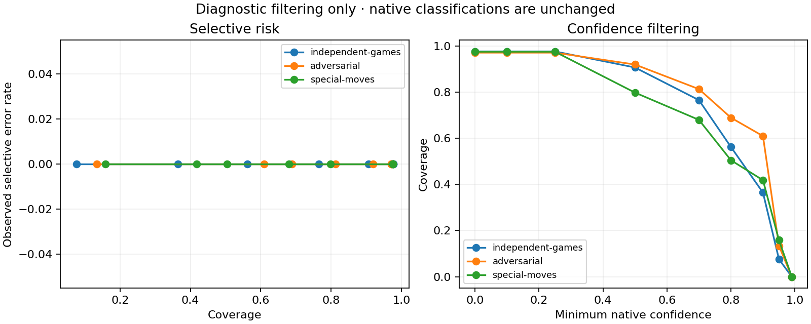

# Strength, confidence and empirical calibration

Native STV strength and confidence remain unchanged. The empirical mapping is fit on 20 calibration games, 100 positions and 11,402 complete candidates from separate opening families. Ten strength bins use Laplace smoothing; empty bins retain zero observations and a one-half estimate. It is a diagnostic frequency estimate, never an inference gate. [Mapping and results](../../artifacts/cycle9/calibration/results.json).

| Held-out cohort (in-board) | Candidates | Raw Brier | Mapped Brier | Raw ECE | Mapped ECE | Raw log loss | Mapped log loss |
|---|---|---|---|---|---|---|---|
| adversarial | 3170 | 0.006616 | 0.002488 | 0.015526 | 0.002497 | 0.023143 | 0.012889 |
| independent-games | 26493 | 0.005278 | 0.000001 | 0.017249 | 0.000485 | 0.021301 | 0.000486 |
| special-moves | 2349 | 0.004090 | 0.001678 | 0.014391 | 0.001653 | 0.019213 | 0.008784 |

The raw-score columns assess numeric diagnostic behavior, not a claim that native STVs have probability semantics. The separate four-score comparison is:

| Held-out cohort (in-board) | Diagnostic score | Candidates | Brier | ECE | Clipped log loss |
|---|---|---|---|---|---|
| adversarial | raw-strength | 3170 | 0.006616 | 0.015526 | 0.023143 |
| adversarial | raw-confidence-as-diagnostic-score | 3170 | 0.155406 | 0.241230 | 0.492900 |
| adversarial | strength-confidence-diagnostic | 3170 | 0.018871 | 0.089786 | 0.104622 |
| adversarial | empirical-calibrated | 3170 | 0.002488 | 0.002497 | 0.012889 |
| independent-games | raw-strength | 26493 | 0.005278 | 0.017249 | 0.021301 |
| independent-games | raw-confidence-as-diagnostic-score | 26493 | 0.265684 | 0.374003 | 0.701249 |
| independent-games | strength-confidence-diagnostic | 26493 | 0.022828 | 0.117063 | 0.131398 |
| independent-games | empirical-calibrated | 26493 | 0.000001 | 0.000485 | 0.000486 |
| special-moves | raw-strength | 2349 | 0.004090 | 0.014391 | 0.019213 |
| special-moves | raw-confidence-as-diagnostic-score | 2349 | 0.220071 | 0.296062 | 0.628541 |
| special-moves | strength-confidence-diagnostic | 2349 | 0.026498 | 0.120611 | 0.138854 |
| special-moves | empirical-calibrated | 2349 | 0.001678 | 0.001653 | 0.008784 |

Confidence-stratified precision/recall and selective risk/coverage retain the original supported classifications; they do not turn unknowns into decisions. Per-piece, special-move and evidence-volume strata report their own sample counts in the linked artifact.

| Held-out cohort (in-board) | Source clusters | Calibrated Brier 95% interval |
|---|---|---|
| adversarial | 64 | 0.000963 – 0.004380 |
| independent-games | 100 | 0.000001 – 0.000001 |
| special-moves | 80 | 0.000400 – 0.003552 |

Overall Brier and accuracy uncertainty resamples source games or controlled pairs (500 deterministic bootstrap draws), conditional on the fitted mapping; it does not include refitting uncertainty from the 20 calibration games. Bin-level Wilson intervals are explicitly naive to within-game dependence. Zero observed error produces a degenerate bootstrap risk interval and does not establish zero population risk. The full intervals and sample sizes are in the JSON; [per-candidate export](../../artifacts/cycle9/calibration/predictions.csv) links every score to its native proof hash. SVG/PDF figures accompany the PNGs.

No mapping was fit to final held-out, adversarial or special-move labels. Performance across these cohorts is evidence about distribution shift, not grounds to retune the mapping on the final test. Independent games are synthetic and related opening families can remain correlated. Calibration does not supply the premise-validity certificates required by the composition proposal.
