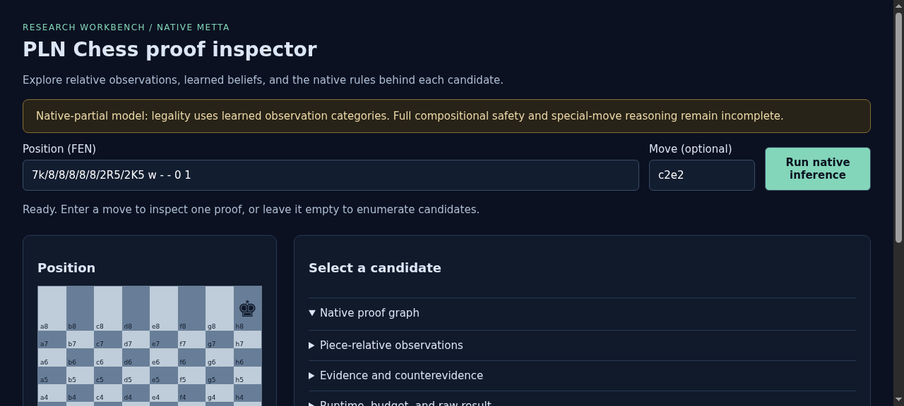
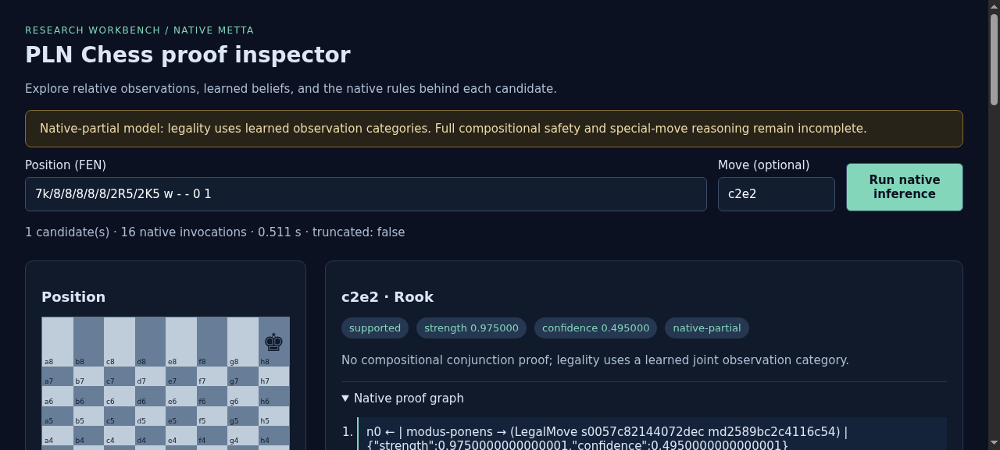

# ProofShot Verification Report

**Date:** 2026-11-05 10:33:11
**Project:** pln-chess
**Dev Server:** .venv/bin/pln-chess serve --port 8765 on localhost:8765

## What Was Verified

PLN chess native proof inspector: board, contrasting proofs, error handling and mobile

## Video Recording

Full session recording: [session.webm](./session.webm) (183s)

## Screenshots

## Console Errors

No console errors detected.

## Server Errors

No server errors detected.

## Environment
- Browser: Chromium (headless)
- Viewport: 1280x720
- Duration: 183 seconds
