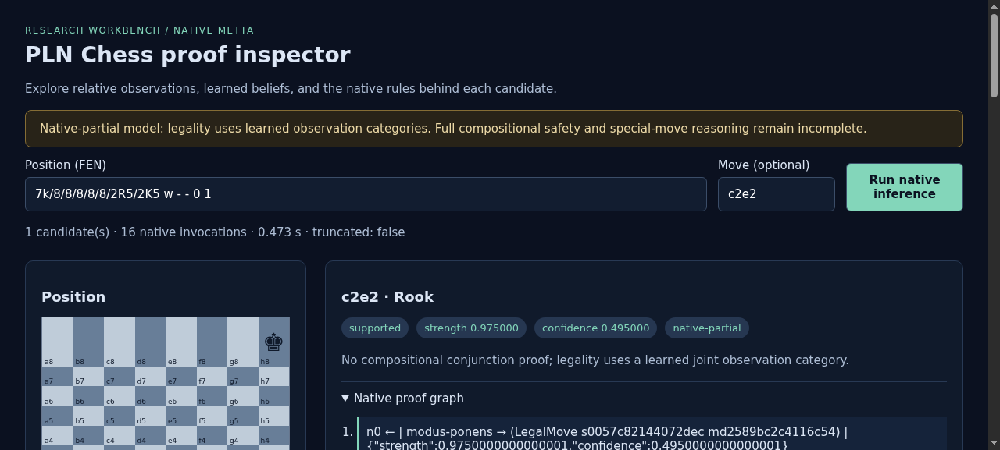

# ProofShot Verification Report

**Date:** 2026-11-05 10:35:47
**Project:** pln-chess
**Dev Server:** .venv/bin/pln-chess serve --port 8765 on localhost:8765

## What Was Verified

Final native PLN inspector verification: clear blocked pinned proofs, complete candidates, replay comparison and mobile

## Video Recording

Full session recording: [session.webm](./session.webm) (79s)

## Screenshots

## Console Errors

No console errors detected.

## Server Errors

No server errors detected.

## Environment
- Browser: Chromium (headless)
- Viewport: 1280x720
- Duration: 79 seconds
