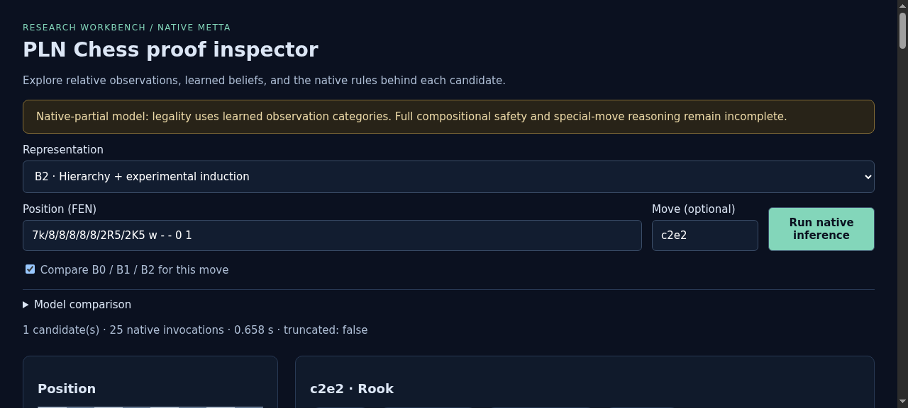
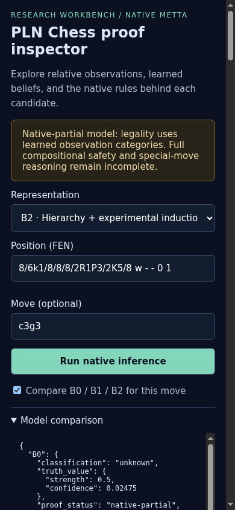
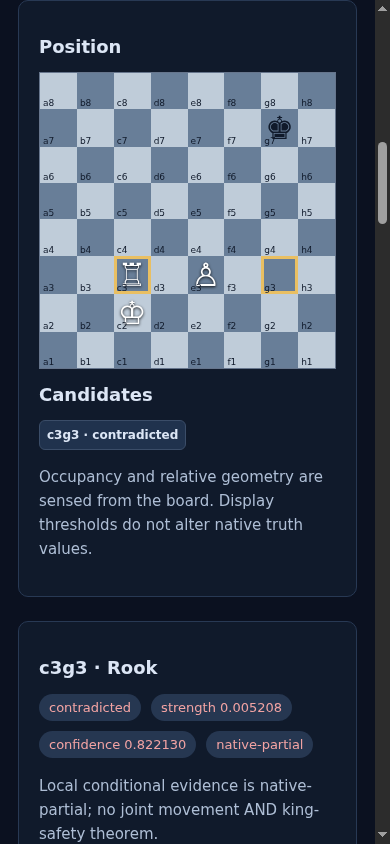
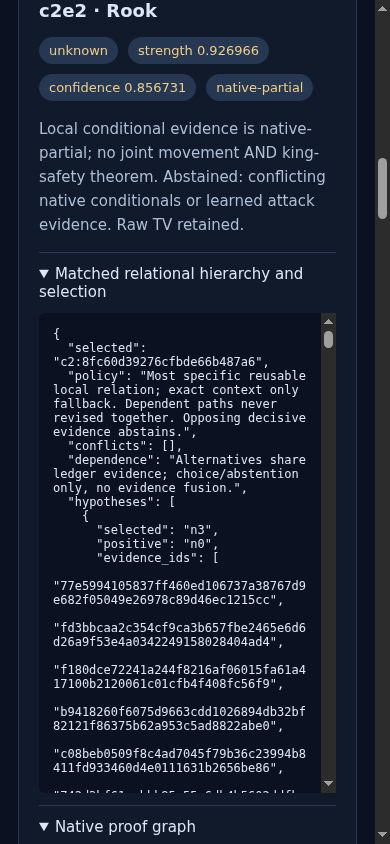
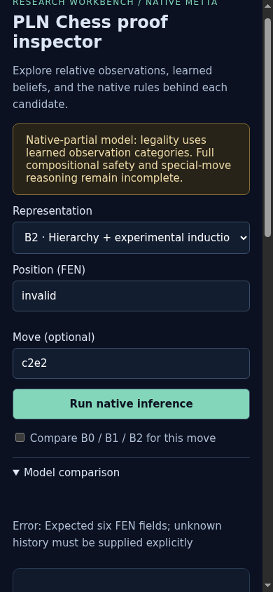
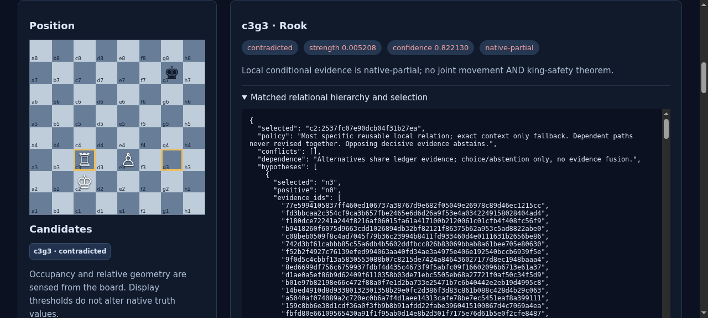

# ProofShot Verification Report

**Date:** 2026-11-05 12:38:29
**Project:** pln-chess
**Dev Server:** .venv/bin/pln-chess serve --port 8765 --checkpoint artifacts/cycle2/B1-model.json on localhost:8765

## What Was Verified

Cycle 2 hierarchical hypotheses, native proof provenance, B0 B1 B2 comparison, and mobile layout

## Video Recording

Full session recording: [session.webm](./session.webm) (341s)

## Screenshots

## Console Errors

No console errors detected.

## Server Errors

No server errors detected.

## Environment
- Browser: Chromium (headless)
- Viewport: 1280x720
- Duration: 341 seconds
