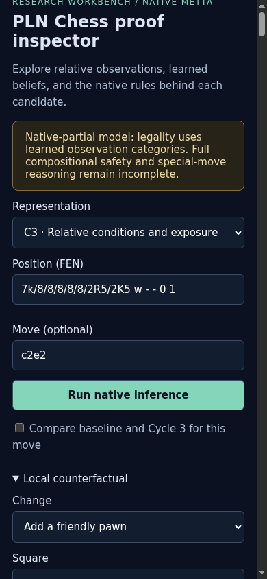
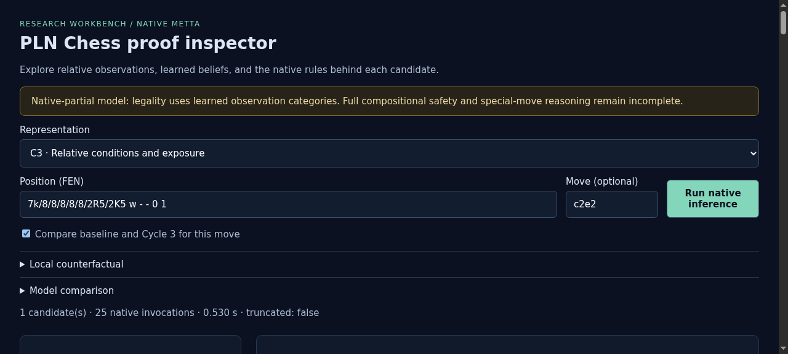
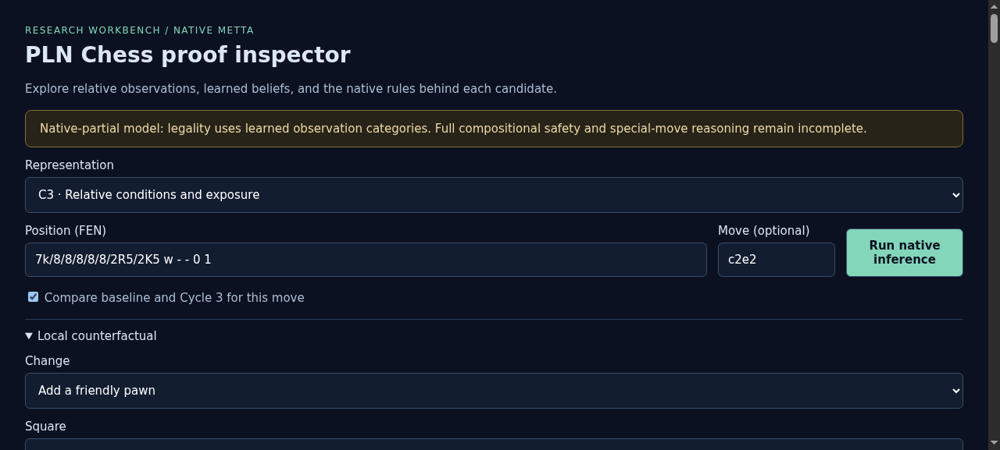
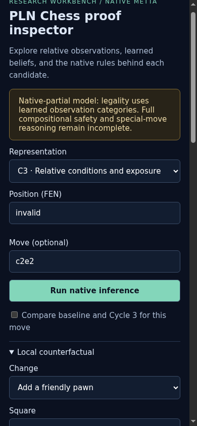
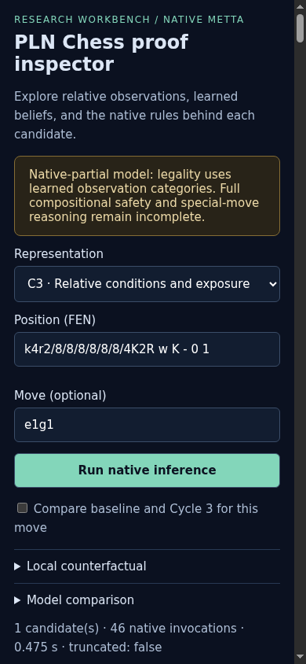
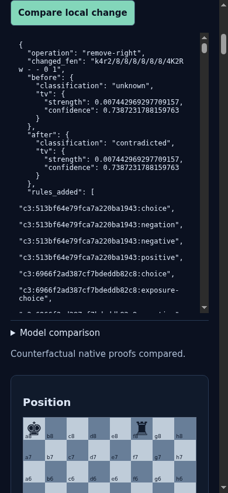
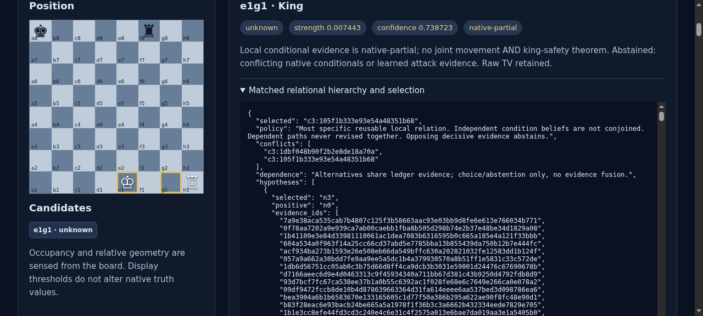

# ProofShot Verification Report

**Date:** 2026-11-05 13:52:29
**Project:** pln-chess
**Dev Server:** .venv/bin/pln-chess serve --port 8765 --checkpoint artifacts/cycle3/C3-full-model.json on localhost:8765

## What Was Verified

Cycle 3 independent condition beliefs, baseline comparison, local counterfactuals and mobile layout

## Video Recording

Full session recording: [session.webm](./session.webm) (157s)

## Screenshots

## Console Errors

No console errors detected.

## Server Errors

No server errors detected.

## Environment
- Browser: Chromium (headless)
- Viewport: 1280x720
- Duration: 157 seconds
