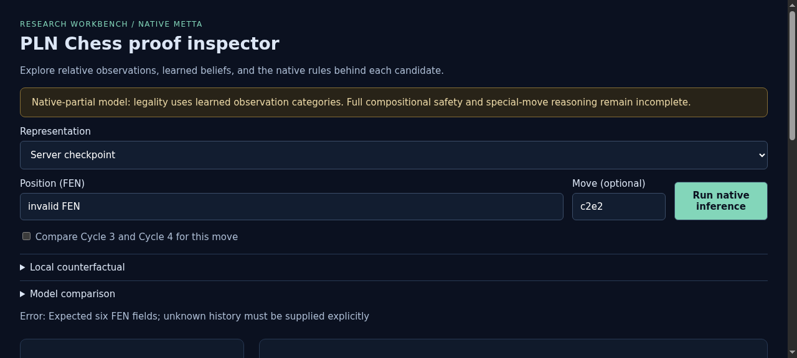
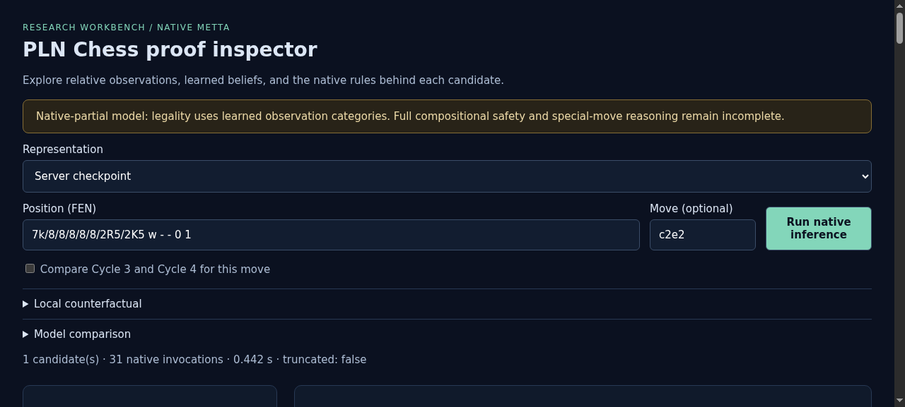

# ProofShot Verification Report

**Date:** 2026-11-05 17:04:57
**Project:** pln-chess
**Dev Server:** .venv/bin/pln-chess serve --port 8765 --checkpoint artifacts/cycle4/model/C4-full.json on localhost:8765

## What Was Verified

Verify final diagnostic export and invalid-input state reset on Cycle 4 inspector

## Video Recording

Full session recording: [session.webm](./session.webm) (209s)

## Screenshots

## Console Errors

No console errors detected.

## Server Errors

No server errors detected.

## Environment
- Browser: Chromium (headless)
- Viewport: 1280x720
- Duration: 209 seconds
