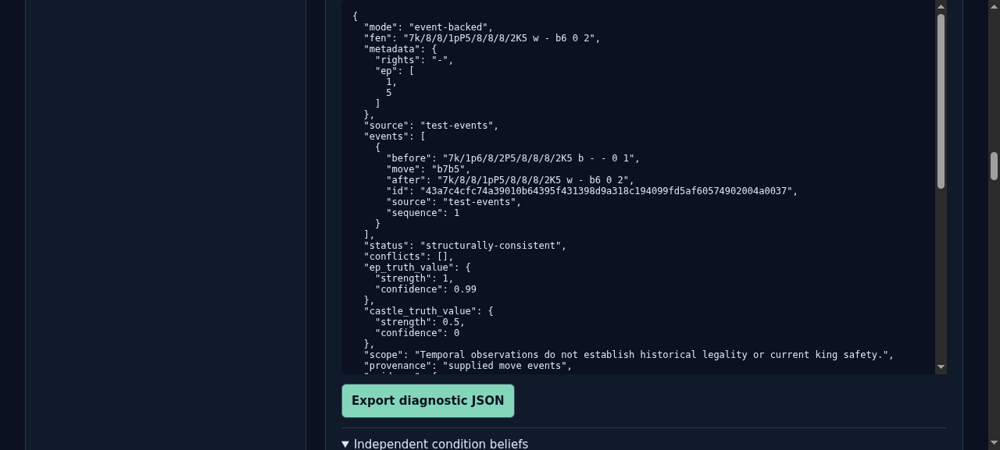
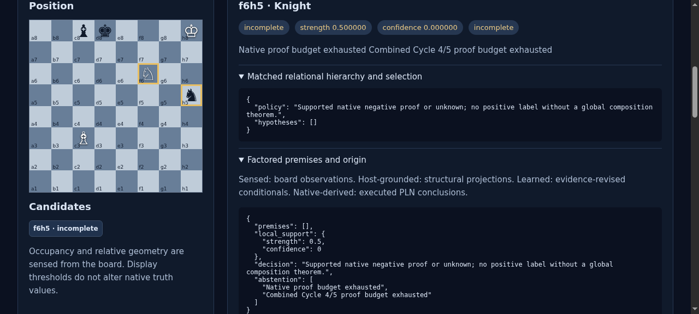
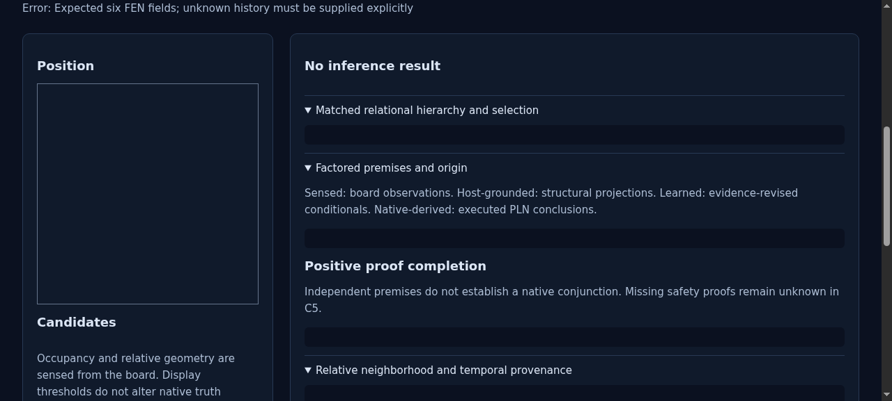
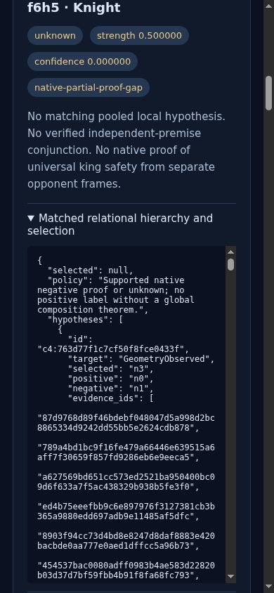
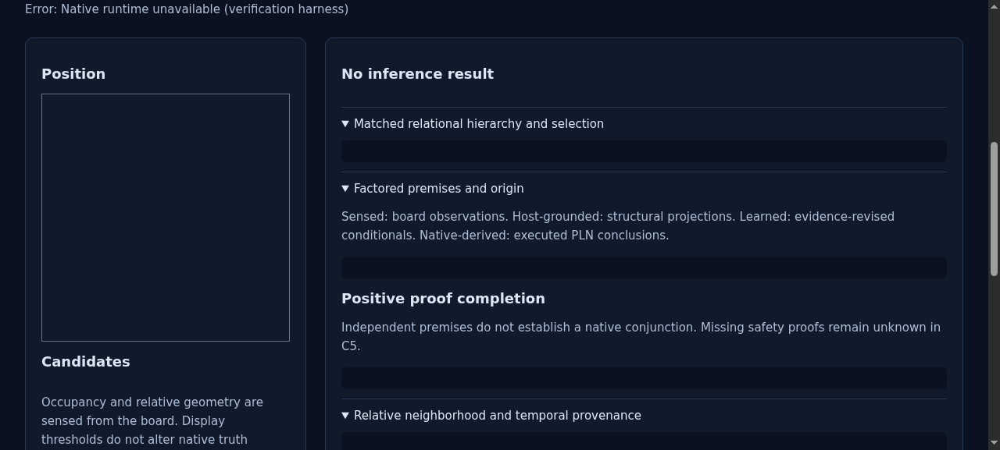
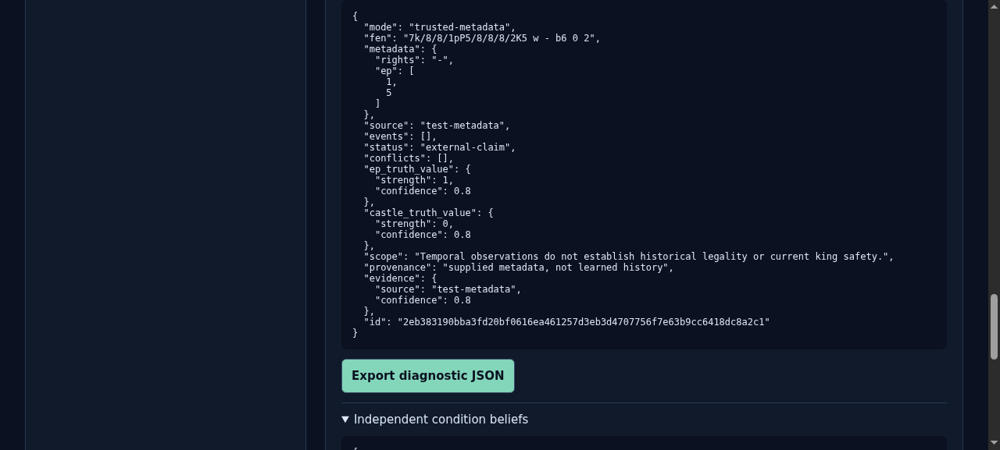

# ProofShot Verification Report

**Date:** 2026-11-05 18:53:55
**Project:** pln-chess
**Dev Server:** TMPDIR=/dev/shm .venv/bin/pln-chess serve --port 8765 --checkpoint artifacts/cycle5/model/C5-full.json on localhost:8765

## What Was Verified

Final Cycle 5 temporal modes, incomplete budget, invalid input, native failure contract and mobile verification

## Video Recording

Full session recording: [session.webm](./session.webm) (146s)

## Screenshots

## Console Errors

No console errors detected.

## Server Errors

No server errors detected.

## Environment
- Browser: Chromium (headless)
- Viewport: 1280x720
- Duration: 146 seconds
